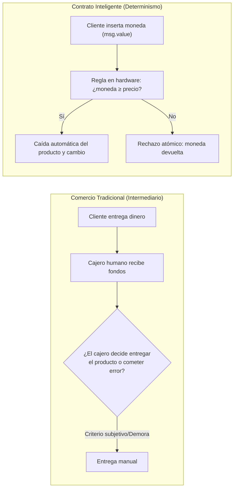
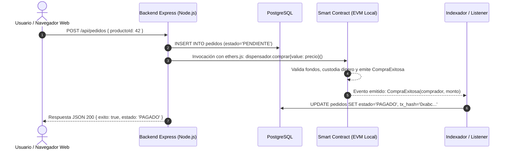

# 00 · Mi Primer Contrato Inteligente y Arquitectura de Sistemas

> **Guía para Aprendices de Análisis y Desarrollo de Software (ADSO)**  
> **Propósito:** Comprender qué es un contrato inteligente desde cero, sin necesidad de conocimientos previos en criptomonedas o finanzas, aprender a programar tu primer contrato paso a paso y entender cómo integrar esta capa en los sistemas de información que construyes a diario (inventarios, logística, facturación y comercio electrónico).

> **Versión web:** este documento acompaña el módulo **00 · Tu primer contrato** del portal (`web/index.html#m0/0`). Allí encuentras el glosario con equivalentes de software tradicional y cuatro diagramas que funcionan sin conexión: cajero frente a máquina dispensadora, ciclo de una transacción, arquitectura con capa programable y árbol de decisión. Los diagramas Mermaid de este archivo se ven en GitHub o en un visor compatible.

---

## 1. La Pregunta Fundamental: ¿Qué es realmente un Contrato Inteligente?

Para entender un contrato inteligente (*Smart Contract*), olvídate por un momento de la especulación financiera, los tokens y las noticias sobre criptomonedas. Para un desarrollador de software, un contrato inteligente es simplemente:

> **Un programa informático (código ejecutable + datos de almacenamiento) desplegado en una red de servidores independientes, cuya ejecución es obligatoria, transparente e imposible de alterar por ninguna persona, ni siquiera por el programador que lo creó.**

### La Analogía Cotidiana: La Máquina Dispensadora de Bebidas

La mejor analogía en el mundo real para entender un contrato inteligente es una **máquina dispensadora de bebidas**:



Piensa en cómo funciona una máquina expendedora:
1. **Reglas explícitas y transparentes:** Hay un rótulo con el precio ($2.000 COP) y una ranura. No hay un empleado intermediario evaluando si le agradas o negociando el costo.
2. **Custodia condicional y atómica:** Cuando insertas el dinero, la máquina retiene las monedas en una cámara intermedia. Si oprimes el botón del producto y el saldo es suficiente, un resorte libera la bebida y entrega el cambio. Si el saldo es insuficiente o se agota el producto, el dinero se te devuelve inmediatamente.
3. **Imposibilidad de fraude unilateral:** Quien diseñó la máquina no puede modificar el precio mientras tu moneda va cayendo por la ranura.

Un **Smart Contract** es exactamente una máquina expendedora digital:
* Las bebidas son los **activos o estados digitales** que gestiona.
* La ranura de monedas es una función marcada como **`payable`** que recibe fondos.
* El mecanismo de caída o rechazo son las **validaciones lógicas (`require` / `revert`)**.
* La máquina misma es una **cuenta autónoma** con su propia dirección y balance.

---

## 2. La Analogía Técnica para el Desarrollador: Un Trigger de Base de Datos que Nadie Puede Borrar

Si ya has trabajado con bases de datos relacionales como PostgreSQL, MySQL o SQL Server, comprende esta relación directa:

| Concepto en Base de Datos Relacional (PostgreSQL) | Concepto en Smart Contract (EVM / Solidity) | ¿Por qué cambia la regla del juego? |
| :--- | :--- | :--- |
| **Tabla con Columnas** | **Variables de Estado (`storage`)** | En PostgreSQL, el administrador de sistemas (`postgres` / `DBA`) puede ejecutar `UPDATE` manual con `psql` y alterar un saldo a voluntad. En un Smart Contract, **ningún superusuario puede forzar un cambio** que viole el código compilado. |
| **Procedimiento Almacenado / Función PL/pgSQL** | **Función Pública del Contrato** | En la base de datos se ejecuta en el CPU del servidor central. En la blockchain se ejecuta idénticamente en miles de nodos que validan el resultado por consenso. |
| **Trigger `BEFORE INSERT / UPDATE`** | **Validación Atómica (`require` / `revert`)** | Si la condición del trigger falla, se ejecuta un `ROLLBACK` total. En Solidity, si un `require` falla, la transacción se cancela, el estado regresa a como estaba antes de la llamada y el dinero transferido regresa a su dueño. |
| **Tabla de Auditoría (`audit_log`)** | **Bitácora de Eventos (`event` / `emit`)** | Una tabla de auditoría en base de datos puede ser truncada (`TRUNCATE TABLE`) si alguien accede a las credenciales maestras. Los eventos de la EVM quedan grabados en los bloques para siempre y son inalterables. |

---

## 3. ¿Qué le añade esta Capa a Nuestros Sistemas de Software Tradicionales?

En el Análisis y Desarrollo de Software (ADSO), la gran mayoría de aplicaciones (90-95 %) funcionan a la perfección con una arquitectura clásica: **Frontend Web/Móvil + API Backend (Node/Java/Python) + Base de Datos Relacional (PostgreSQL)**.

¿Por qué querríamos añadir una capa de Smart Contracts?

```mermaid
flowchart TD
    subgraph Problema_Centralizado["El Dilema de la Confianza en Sistemas Centralizados"]
        A1["Empresa Compradora (Supermercado)"] -.->|No confía en la base de datos de B| B1[Servidor Central de Empresa B]
        A2["Cooperativa de Campesinos"] -.->|Teme que el comprador altere registros de pago| B1
        B1 --> DB1[("PostgreSQL Privado<br/>El administrador puede editar saldos")]
    end

    subgraph Solucion_Hibrida["Arquitectura Híbrida ADSO (CQRS)"]
        C1["Supermercado (Comprador)"] --> API["Backend API (Node.js / Express)"]
        C2["Cooperativa Campesina"] --> API
        API -->|Lecturas ultra-rápidas < 5ms| PG[("PostgreSQL Local<br/>Inventarios, Perfiles, Catálogos")]
        API -->|Transacciones de custodia neutral| SC["Contrato Inteligente (EVM)<br/>Custodia de fondos y liquidación automática"]
        SC -->|Emisión de Eventos| IDX["Worker / Indexador CQRS"]
        IDX -->|Actualiza estado sincronizado| PG
    end
```



### Los Tres Superpoderes que Añade el Dinero Programable a tu Software:

1. **Custodia Neutral Sin Intermediarios Financieros (Escrow):**
   * *Sin Smart Contract:* Para garantizar que un comprador pague cuando reciba mercancía, se debe contratar una fiduciaria, un banco o un servicio como MercadoPago/PayPal, los cuales cobran comisiones altas (3 % - 8 %), exigen trámites jurídicos y pueden congelar fondos unilateralmente.
   * *Con Smart Contract:* El contrato retiene los fondos en garantía de forma neutral. Ni el comprador puede recuperar la plata si la mercancía llegó bien, ni el vendedor puede cobrar antes de entregarla. La liberación es matemática.

2. **Liquidación Condicional Automatizada:**
   * Las reglas de negocio que implican desembolso de dinero se ejecutan en milisegundos cuando se cumple una condición observable (por ejemplo: confirmación de entrega por GPS, medición de sensor de cadena de frío o certificación de control de calidad).

3. **Inmutabilidad y Trazabilidad Multipartita:**
   * Cuando varias organizaciones (proveedores, transportadores, clientes, entidades públicas) deben compartir información crítica, nadie tiene que confiar en la base de datos de los demás. La blockchain actúa como el libro mayor neutral compartido.

---

## 4. Comparación Integral: Arquitectura Tradicional vs. Arquitectura con Capa Programable

| Característica | Arquitectura Tradicional (Web2) | Arquitectura con Dinero Programable (Web3 Híbrida) |
| :--- | :--- | :--- |
| **Identidad del Usuario** | Correo electrónico + Contraseña / JWT / OAuth. | Clave criptográfica pública/privada (`0x1a2b...`). |
| **Custodia del Dinero** | Banco centralizado o pasarela de pagos (Stripe, PSE, Wompi). | La propia cuenta del Smart Contract (`address(this).balance`). |
| **Ejecución de Pagos** | Invocación asíncrona a una API REST externa (`POST /v1/charges`). | Instrucción nativa en la transacción (`msg.value` / `call{value}`). |
| **Garantía de Regla** | Promesa institucional de la empresa administradora. | Cumplimiento criptográfico forzado por consenso de red. |
| **Costos de Cómputo** | Factura mensual fija de hosting/servidor (AWS, DigitalOcean). | Gas por transacción pagado por quien muta el estado. |
| **Lectura de Datos** | Consultas SQL (`SELECT * FROM lotes WHERE estado = 'PAGADO'`). | Eventos sincronizados hacia PostgreSQL bajo patrón CQRS. |
| **Rollback / Fallos** | Manejo manual en código de aplicación (`catch` con reversión en BD). | Reversión atómica nativa (`revert` deshace el 100 % de los cambios). |

---

## 5. Tu Primer Contrato Inteligente Línea por Línea: `DispensadorDigital.sol`

A continuación, construiremos tu primer contrato en Solidity. Es un contrato corto que simula una máquina dispensadora que vende un artículo por un precio fijo.

```solidity
// SPDX-License-Identifier: MIT
pragma solidity =0.8.24;

/// @title DispensadorDigital
/// @notice Simula una máquina dispensadora que cobra un precio fijo y entrega un producto digital.
contract DispensadorDigital {
    // 1. Constante inmutable: el precio de cada artículo en unidades mínimas de valor (wei)
    uint256 public immutable precioArticulo;
    
    // 2. Variable de estado persistente: la dirección de la persona dueña de la máquina
    address public immutable dueno;

    // 3. Bitácora de eventos: notifica a nuestras aplicaciones web externas cada vez que ocurre una venta
    event CompraExitosa(address indexed comprador, uint256 montoPagado);
    event FondosRetirados(address indexed dueno, uint256 montoRetirado);

    // Errores descriptivos que ahorran costos de ejecución (gas)
    error PagoInsuficiente(uint256 enviado, uint256 requerido);
    error SoloDuenoPuedeRetirar();
    error SinSaldoParaRetirar();
    error FalloAlRetirar();

    /// @notice Se ejecuta UNA SOLA VEZ cuando el contrato nace en la red (despliegue)
    constructor(uint256 precioInicial) {
        precioArticulo = precioInicial;
        dueno = msg.sender; // msg.sender es la cuenta que desplegó el contrato
    }

    /// @notice Función para comprar: la palabra clave 'payable' le permite RECIBIR DINERO REAL
    function comprar() external payable {
        // Regla de negocio: ¿el comprador insertó suficiente dinero en la ranura?
        if (msg.value < precioArticulo) {
            revert PagoInsuficiente(msg.value, precioArticulo);
        }

        // Si cumple la regla, emitimos el evento notarial para que nuestro backend lo registre
        emit CompraExitosa(msg.sender, msg.value);
    }

    /// @notice Permite al dueño de la máquina retirar las ganancias acumuladas
    function retirarGanancias() external {
        if (msg.sender != dueno) revert SoloDuenoPuedeRetirar();

        uint256 saldoTotal = address(this).balance;
        if (saldoTotal == 0) revert SinSaldoParaRetirar();

        // Transferencia segura al dueño
        (bool exito, ) = dueno.call{value: saldoTotal}("");
        if (!exito) revert FalloAlRetirar();

        emit FondosRetirados(dueno, saldoTotal);
    }
}
```

### Anatomía Pedagógica del Contrato:

1. **`// SPDX-License-Identifier: MIT`**: Declara la licencia del código fuente abierto.
2. **`pragma solidity =0.8.24;`**: Le indica al compilador de Solidity la versión exacta que debe utilizarse para evitar inconsistencias de sintaxis.
3. **`contract DispensadorDigital`**: Define el bloque principal. Equivale a una clase en Java o C#, pero con su propia cuenta y memoria permanente en la cadena.
4. **`uint256 public immutable precioArticulo;`**: Un entero positivo de 256 bits sin signo (desde 0 hasta $2^{256}-1$). Al ser `immutable`, se guarda en el código binario y no gasta ranuras caras de almacenamiento dinámico.
5. **`payable`**: Este modificador es el más importante de Solidity. Si una función **no** tiene `payable`, la máquina virtual rechazará automáticamente cualquier intento de enviarle dinero. Solo las funciones con `payable` pueden recibir valor.
6. **`msg.sender`**: Representa la dirección criptográfica de la persona o contrato que invocó la función. No se puede falsificar porque viene respaldada por la firma de curva elíptica de la transacción.
7. **`msg.value`**: La cantidad exacta de dinero (en wei, la fracción más pequeña de ether) enviada en esta llamada.
8. **`emit CompraExitosa(...)`**: Notifica al mundo exterior que la regla se cumplió. Tu servidor de Node.js o tu aplicación web estarán escuchando este evento para entregar el producto en tu base de datos PostgreSQL.
9. **`revert`**: Detiene la ejecución de inmediato, cancela los cambios y reembolsa el dinero al usuario.

---

## 6. Blueprint de Integración Fullstack: Conectando el Contrato a tu Sistema ADSO

¿Cómo conectamos este contrato con un sistema empresarial común en Node.js, Express y PostgreSQL sin que los clientes finales tengan que instalar billeteras ni saber de criptomonedas?

### Diagrama del Flujo de Integración



### Ejemplo de Código en Node.js / Express (Backend Tradicional):

```javascript
// backend/servicio-dispensador.js
const { ethers } = require('ethers');
const db = require('./base-de-datos'); // Pool de PostgreSQL

// 1. Conexión al nodo local (Hardhat / EVM privada)
const provider = new ethers.JsonRpcProvider('http://127.0.0.1:8545');
// Cuenta custodia del sistema (llave privada gestionada en variables de entorno del servidor)
const signer = new ethers.Wallet(process.env.OPERADOR_PRIVATE_KEY, provider);

// 2. Instancia del contrato con su ABI y dirección desplegada
const CONTRATO_ABI = [
  'function comprar() external payable',
  'function precioArticulo() external view returns (uint256)',
  'event CompraExitosa(address indexed comprador, uint256 montoPagado)'
];
const dispensador = new ethers.Contract(process.env.DISPENSADOR_ADDRESS, CONTRATO_ABI, signer);

// 3. Endpoint Express normal de compra
async function procesarCompra(req, res) {
  const { clienteId, productoId } = req.body;

  try {
    const precio = await dispensador.precioArticulo();

    // El servidor ejecuta la transacción en la EVM en nombre de la operación de negocio
    const tx = await dispensador.comprar({ value: precio });
    const recibo = await tx.wait(); // Espera a que el bloque confirme la transacción

    // Actualizamos la base de datos relacional para consultas de la interfaz
    await db.query(
      `INSERT INTO compras (cliente_id, producto_id, tx_hash, estado, fecha) 
       VALUES ($1, $2, $3, 'CONFIRMADO', NOW())`,
      [clienteId, productoId, recibo.hash]
    );

    return res.status(200).json({
      mensaje: 'Compra procesada exitosamente en la capa programable.',
      reciboCriptografico: recibo.hash,
      bloqueConfirmado: recibo.blockNumber
    });
  } catch (error) {
    return res.status(400).json({
      error: 'La transacción fue rechazada por la regla del contrato.',
      detalle: error.message
    });
  }
}
```

### ¿Por qué esta arquitectura es segura y práctica para un aprendiz?
1. **Los usuarios no necesitan saber de cripto:** Los usuarios inician sesión con su usuario y contraseña habituales.
2. **El backend gestiona la interacción segura:** Las claves y transacciones con la capa programable ocurren en el servidor o mediante cuentas asignadas del sistema.
3. **PostgreSQL sigue siendo el rey de las lecturas:** Para mostrar listas, historiales, reportes en PDF y búsquedas, se consulta PostgreSQL en menos de 5 milisegundos.
4. **La blockchain es la dueña de la verdad financiera:** Si alguien intenta manipular la base de datos de PostgreSQL para decir que "pagó sin pagar", el sistema puede cotejar la columna `tx_hash` contra el contrato inteligente y detectar la discrepancia de inmediato.

---

## 7. Próximo Paso en tu Ruta de Aprendizaje

Ahora que comprendes:
* Qué es un contrato inteligente con la analogía de la máquina dispensadora.
* Su equivalencia técnica con un trigger de base de datos inmutable.
* La anatomía de un contrato en Solidity (`payable`, `msg.value`, `require`, `emit`).
* Cómo integrarlo a una API REST tradicional en Node.js y PostgreSQL.

Estás listo para avanzar al **Taller AgroPay**, donde aplicarás estos mismos principios a un caso de práctica de trazabilidad agropecuaria y pagos automatizados a productores con oráculos de control de calidad.
