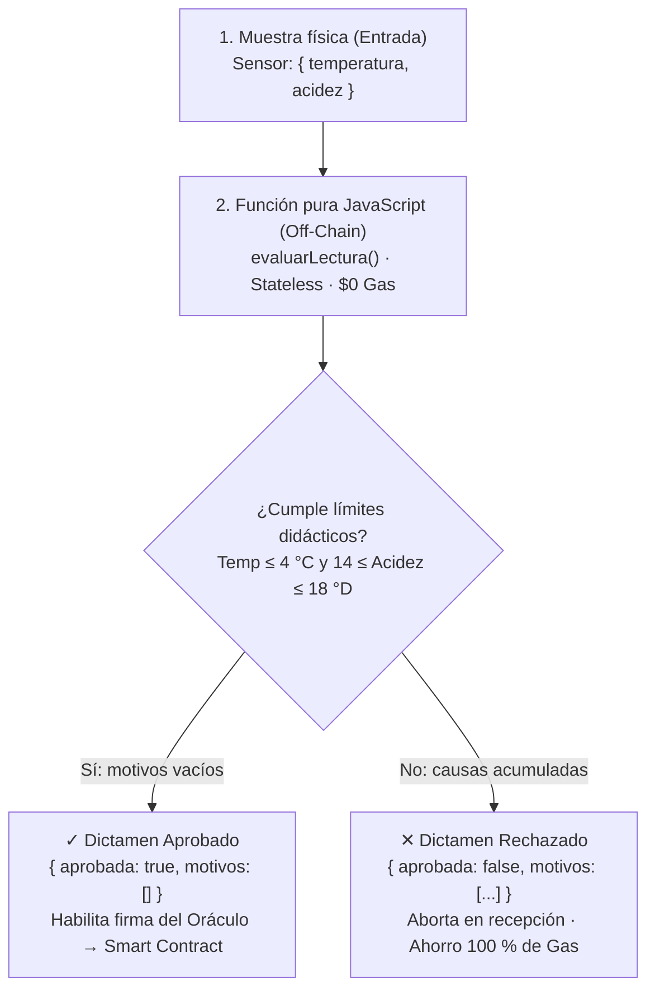

# 01 · Fundamentos y Decisión: El Dinero Programable

El dinero programable es la evolución financiera impulsada por la tecnología blockchain y los contratos inteligentes (smart contracts). Como desarrollador de software, esto te permite crear aplicaciones donde el valor y la lógica de negocio se ejecutan sin intermediarios, de forma determinista e inmutable.

## ¿Qué es el dinero programable?
A diferencia de las pasarelas de pago tradicionales (como Stripe o PayPal) donde dependes de una API controlada por un tercero, el dinero programable vive en redes descentralizadas. Tú escribes el código que dicta exactamente cómo, cuándo y bajo qué condiciones se mueve el dinero.

### Redes principales para desarrolladores:
1. **Bitcoin:** Fue el pionero. Su lenguaje de programación (`Script`) es intencionalmente limitado (no Turing-completo) por seguridad. Se usa principalmente como reserva de valor, aunque tecnologías como *Lightning Network* o *Stacks* permiten programabilidad adicional.
2. **Ethereum:** Es la plataforma reina para los desarrolladores. Su máquina virtual (EVM) y su lenguaje **Solidity** (similar a JavaScript/C++) son Turing-completos. Aquí puedes programar desde tokens (ERC-20), NFTs (ERC-721), hasta organizaciones autónomas (DAOs) y finanzas descentralizadas (DeFi).
3. **IOTA:** Nació para el Internet de las Cosas con un grafo acíclico dirigido (Tangle). La red actual usa contratos en Move en su capa principal, ofrece un entorno EVM separado y cobra tarifas de gas. La descripción histórica de «micropagos sin comisiones» no describe la plataforma vigente; consulta su documentación oficial antes de decidir.
4. **Solana / Polkadot / Cardano:** Alternativas de alta velocidad o arquitecturas modulares, utilizando lenguajes como Rust o Haskell.

## Inteligencia Artificial + Dinero Programable
Unir la IA con blockchain te abre las puertas a aplicaciones de próxima generación:
- **Agentes económicos autónomos:** Un modelo de IA que gestiona un presupuesto en cripto. Puede decidir comprar poder de cómputo, pagar a APIs externas o invertir, firmando transacciones por su cuenta.
- **Oráculos Inteligentes:** Los contratos inteligentes están aislados de internet. Para que tu contrato sepa si un vuelo se retrasó o cuál es el análisis de sentimiento de una noticia (hecho por un LLM), utilizas oráculos (como Chainlink) para inyectar decisiones de IA on-chain.
- **Mercados de datos y modelos:** Pagar fracciones de centavo automáticamente cada vez que alguien consulta tu modelo de IA.

## La Arquitectura Híbrida: Blockchain + PostgreSQL (Patrón CQRS)
En el desarrollo de software real (ADSO), la blockchain no reemplaza a tu base de datos relacional:
* **Blockchain (EVM):** Es la máquina de verdad inmutable (Write Model). Se encarga de la custodia neutral de fondos, reglas de liquidación condicional y sellos criptográficos.
* **PostgreSQL:** Es el motor de lectura y reportes (Read Model). Se alimenta de los eventos emitidos por los contratos a través de un indexador idempotente (`UNIQUE(tx_hash, log_index)` con `ON CONFLICT DO NOTHING`). Resuelve búsquedas y vistas en menos de 5 ms.

> 📖 Consulta la guía de ingeniería completa: [`docs/ARQUITECTURA_BLOCKCHAIN_Y_POSTGRES_ADSO.md`](ARQUITECTURA_BLOCKCHAIN_Y_POSTGRES_ADSO.md).

## Marco de Decisión: El Semáforo ADSO
¿Cómo saber si tu proyecto formativo debe usar blockchain o una base de datos tradicional? Aplica el filtro de tres preguntas:

1. **¿Hay múltiples organizaciones o actores con intereses contrapuestos que no confían en un único administrador?**
2. **¿Existe custodia de fondos económicos, pagos condicionados o necesidad de que ni el programador pueda alterar el registro?**
3. **¿Las condiciones de desembolso pueden definirse matemáticamente en código?**

* **🟢 Verde (Solo PostgreSQL):** Inventarios, catálogos, perfiles de usuario, facturación interna (95 % de los sistemas comunes).
* **🟡 Amarillo (PostgreSQL + Criptografía):** Auditorías con sellos de tiempo y hashes SHA-256 en bases de datos relacionales.
* **🟣 Púrpura (Arquitectura Híbrida):** Garantías de pago entre desconocidos, liquidaciones agrícolas automáticas, trazabilidad internacional y certificados de grado infalsificables.

## El Filtro de Entrada: Reglas Puras en JavaScript vs Ejecución On-Chain (Etapa 1 del Taller)

### Analogía del centro de acopio lechero
Cuando un camión cisterna cargado de leche fresca llega a una cooperativa agropecuaria, el operario de recibo no emite de inmediato la orden de pago bancario ni registra la compra definitiva en el sistema financiero central. Primero, con el camión detenido en la bahía de recepción, toma una muestra directa y mide dos variables críticas: temperatura y acidez.

Si la leche perdió frío (> 4 °C) o la acidez se elevó fuera del rango normal (14 a 18 °Dornic por fermentación bacteriana), el lote se rechaza en la puerta. No se emite cheque, no se procesa la leche y no se compromete dinero.

En el desarrollo de software, la función `evaluarLectura()` en `src/reglas.js` cumple exactamente ese papel: se ejecuta en JavaScript puro fuera de la cadena (*Off-chain*), tarda menos de 1 milisegundo y tiene **costo cero en gas ($0)**. Si el lote no satisface los estándares, el proceso se detiene de inmediato con una explicación clara y jamás llega a la blockchain, evitando saturar la red con transacciones destinadas al fracaso.

### Diagrama del pipeline de evaluación y dictamen explicable

### Tabla de umbrales y valor pedagógico

| Parámetro | Rango aceptado | Condición de rechazo | Justificación técnica para el aprendiz |
|---|---|---|---|
| **Temperatura** | ≤ 4,0 °C | > 4,0 °C | Límite superior de la cadena de frío. Previene la proliferación bacteriana en almacenamiento. |
| **Acidez química** | 14,0 a 18,0 °Dornic | < 14,0 °D o > 18,0 °D | Ventana de control con frontera inferior y superior. Descarta leche adulterada o fermentada. |
| **Validación de tipos** | Número finito estricto | `NaN`, `null`, `string`, `undefined` | Función auxiliar `comprobarNumero()`. Rechaza entradas malformadas antes de evaluar la lógica. |

### ¿Por qué un dictamen explicable y acumulativo?
Un software empresarial no debe responder únicamente con un booleano (`true`/`false`) ni lanzar excepciones descontroladas ante datos inválidos de negocio. La función devuelve `{ aprobada: boolean, motivos: string[] }`. Si fallan tanto la temperatura como la acidez, el arreglo acumula ambas causas, permitiendo generar un reporte forense transparente que explica al productor agropecuario exactamente por qué no se aprobó su lote.

