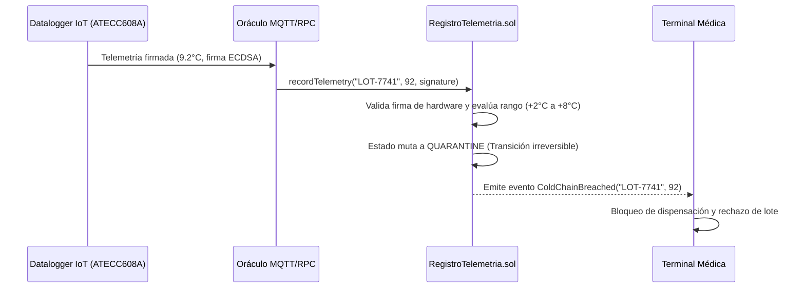
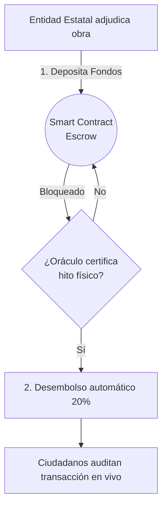

# Casos de Uso ADSO: Dinero Programable en el Mundo Real

Como Tecnólogo en Análisis y Desarrollo de Software (ADSO), tu objetivo no es solo escribir código, sino resolver problemas reales de negocio y sociedad. La blockchain y los contratos inteligentes ofrecen soluciones únicas para industrias que requieren **trazabilidad, transparencia y confianza sin intermediarios**.

A continuación, exploramos los casos de uso multi-industria más relevantes, su hardware criptográfico asociado y las especificaciones técnicas para su implementación profesional.

---

## 1. Cadena de Frío Farmacéutica & Medicamentos Biológicos

Los medicamentos biológicos (como vacunas de ARN mensajero o insulina) pierden su eficacia o se vuelven tóxicos si se rompe la cadena de frío (+2.0°C a +8.0°C). En los sistemas tradicionales, las auditorías son en papel o en bases de datos modificables a posteriori por el transportista.

### Arquitectura de la Solución:
* **Tokenización del Lote:** Cada lote se acuña en el laboratorio fabricante como un token ERC-721 con estado mutable (`ACTIVE`, `QUARANTINE`, `ADMINISTERED`).
* **Hardware de Silicio:** Datalogger IoT con criptochip **Microchip ATECC608A** y sonda térmica **PT100 de grado médico**. El sensor firma la temperatura cada 60 segundos con clave privada que nunca sale del silicio.
* **Envases Anticlonación:** Etiquetas NFC **NXP NTAG 424 DNA** con protocolo SUN (Secure Unique NFC). Cada lectura física genera una URL única firmada criptográficamente (AES-128 CMAC), haciendo imposible clonar el frasco.
* **Garantía Inmutable:** Si la temperatura supera los +8.0°C o desciende de +2.0°C, el contrato inteligente ejecuta una transición irreversible al estado `QUARANTINE`. Ningún hospital o enfermero puede aplicar el lote ni liquidar su pago.

---

## 2. Autenticidad de Miel Pura & Combate al Fraude Alimentario

La miel es el tercer producto más adulterado del mundo. Comerciantes inescrupulosos rebajan la miel con jarabes de maíz o caña de azúcar (C4) o la sobrecalientan para licuar cristales, destruyendo sus enzimas naturales.

### Parámetros Físico-Químicos del Smart Contract:
1. **Humedad (Refractometría Digital Abbe):** Debe ser estrictamente menor al **20.0%** (según Codex Alimentarius Stan 12-1981). Superar este valor implica riesgo de fermentación microbiana.
2. **HMF (Hidroximetilfurfural):** Máximo **40.0 mg/kg**. Valores superiores demuestran sobrecalentamiento forzado o envejecimiento excesivo.
3. **Relación Isotópica de Carbono $\delta^{13}C$ (Espectrometría IRMS):** La diferencia entre el $\delta^{13}C$ de la miel y el de su proteína pura no debe exceder $-1.0‰$. Una firma isotópica superior revela adulteración con jarabe de maíz C4.

### Veredicto y Acuñación de Denominación de Origen:
Si los análisis certificados de laboratorio (LIMS) cumplen los tres criterios, el contrato inteligente acuña un certificado **NFT ERC-721** con los metadatos inmutables sellados en **IPFS**. En caso contrario, la transacción revierte con el error `QualityThresholdNotMet()` y el lote queda descalificado para exportación.

---

## 3. Elecciones Democráticas & Soberanía Digital con ZK-SNARKs

Los sistemas de votación digital tradicionales fallan porque el administrador de la base de datos puede alterar registros o porque no existe forma de auditar el conteo sin vulnerar el secreto del voto.

### Esquema Criptográfico Groth16:
* **Tokens Soulbound Quemables (ERC-5192):** Cada ciudadano registrado en el censo recibe un token intransferible.
* **Prueba de Cero Conocimiento (ZK-SNARK):** Con el protocolo **Semaphore** (cuyos circuitos se escriben en Circom), el votante demuestra que posee un token de voto válido sin revelar su identidad ni el candidato elegido.
* **Nullifier Anti-Replay:** La función matemática genera un identificador único derivado del voto (`nullifierHash`). El contrato almacena `mapping(bytes32 => bool) public usedNullifiers`. Si el ciudadano intenta votar por segunda vez, el contrato revierte con `NullifierAlreadyUsed()`.
* **Hardware de Respaldo:** Urnas con **HSM FIPS 140-2 Nivel 3** e impresoras criptográficas **VVPAT** que generan resguardos físicos en papel con código QR firmado para auditoría ciudadana fuera de línea.

---

## 4. Inclusión Financiera & Contratación Estatal

### Inclusión Financiera en Regiones Marginadas:
* **Stablecoins Soberanas:** Transferencias instantáneas de valor indexado al peso o dólar a través de dispositivos móviles sin intermediación bancaria tradicional.
* **Microcréditos con Evaluación por IA:** Historial de cumplimiento registrado *on-chain* que construye un perfil de crédito descentralizado auditable.

### Contratación del Estado & Licitaciones Públicas:
* **Fideicomisos Programables (Escrow):** Fondos públicos custodiados en contratos inteligentes que solo liberan anticipos cuando oráculos independientes (supervisores de obra e imágenes satelitales procesadas por IA) verifican los hitos pactados.

---

## 5. Matriz Comparativa Multi-Industria Integral

| Criterio Arquitectónico | Elecciones Democráticas | Fármacos & Cadena de Frío | Miel Pura & Denominación |
| :--- | :--- | :--- | :--- |
| **Tipo de Token** | Soulbound Quemable (ERC-5192) | ERC-721 / ERC-1155 (Estado Mutante) | NFT Certificación ERC-721 + IPFS |
| **Hardware de Entrada** | DNIe ISO 7816, HSM FIPS 140-2, VVPAT | Criptochip ATECC608A, NFC NTAG 424 DNA | Espectrómetro IRMS, Refractómetro Abbe |
| **Privacidad del Dato** | Máxima (Pruebas ZK-SNARK Groth16) | Pública / Seudo-anónima por Lote | Pública para el Consumidor Final |
| **Amenaza Crítica** | Coerción, Doble Voto, Violación Secreto | Desnaturalización Térmica, Falsificación | Adulteración con Jarabe C4, Sobrecalentamiento |
| **Rol del Auditor ADSO** | Verificación de pruebas Semaphore y nullifiers | Validación de Firmas ECDSA del Criptochip | Auditoría de Fórmulas Matemáticas LIMS |

---

## 💡 El camino más fácil para el Desarrollador ADSO (BaaS)

Como tecnólogo en ADSO, **no necesitas crear una blockchain desde cero**:

1. **Smart Contracts:** Diseñas y compilas en Solidity o Vyper con el compilador nativo de Hardhat o Foundry.
2. **Infraestructura Privada o Pública:**
   * **Redes de Consorcio Empresarial:** Algunas organizaciones operan **Hyperledger Besu** con consenso QBFT y validadores identificados. Es un tema de arquitectura para comparar; esta guía no despliega esa red.
   * **Redes Públicas:** Usas **Account Abstraction (ERC-4337)** con contratos **Paymaster** para que los usuarios nunca deban comprar criptomonedas.
3. **Frontend React / Next.js:** Conectas la interfaz mediante **Viem** y **Wagmi** integrando autenticación biométrica **WebAuthn (Passkeys)** para una experiencia de usuario idéntica a una aplicación bancaria moderna.
4. **Persistencia CQRS:** Sincronizas eventos de contratos inteligentes hacia **PostgreSQL** mediante indexadores para alimentar tableros y consultas complejas en menos de 1 milisegundo.
