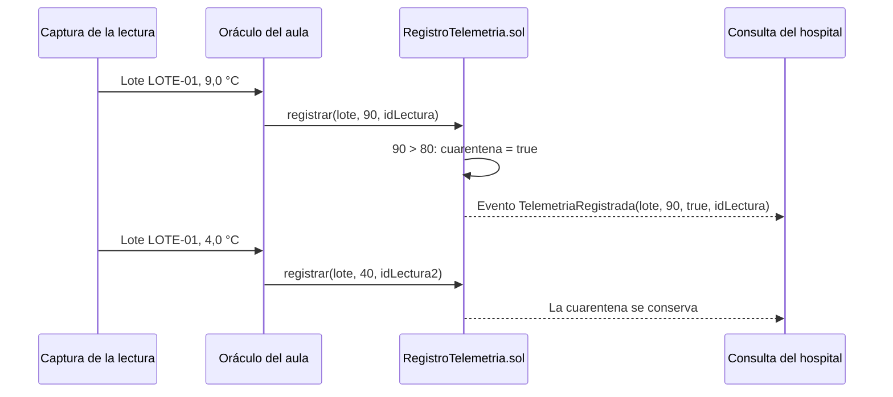
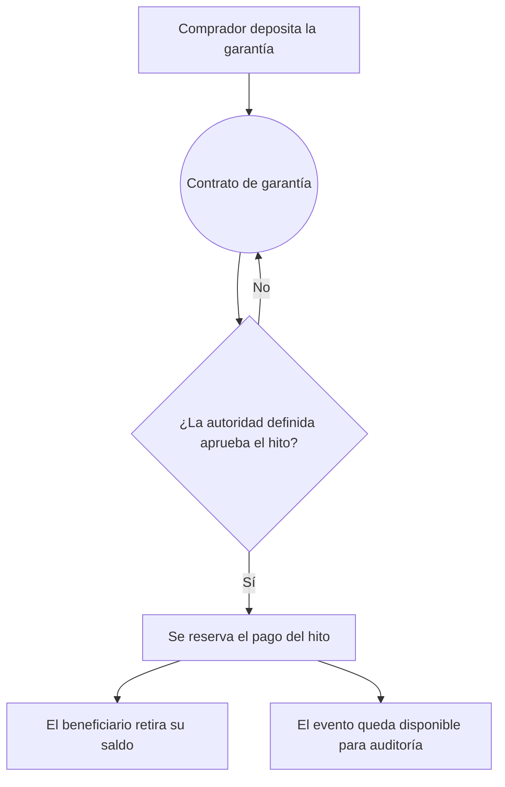

# Casos de uso ADSO: dinero programable con límites claros

Este documento acompaña el módulo 2 de la guía, «Casos de uso y decisiones» (`#m2/0`). Los casos, lotes y umbrales se prepararon para aprender y no contienen registros reales: no certifican medicamentos, alimentos ni elecciones.

Cada caso sigue la misma estructura del módulo: actores, dato que nace fuera de la red, regla, qué guarda el contrato del aula y qué queda fuera de la cadena. Al final de cada caso, un bloque separa lo que haría un sistema de producción, que esta guía no implementa.

---

## 1. Cadena de frío de medicamentos

Un laboratorio despacha un lote que debe conservarse entre 2 a 8 °C durante el transporte. El hospital necesita saber si el lote rompió esa condición, aunque la última lectura sea correcta.

| Parte | En el aula |
| :--- | :--- |
| **Actores** | Laboratorio, transportista, hospital y el oráculo que registra lecturas. |
| **Dato externo** | Temperatura del lote, ingresada por software en el laboratorio Cadena de frío. |
| **Regla** | Fuera de 2 a 8 °C, el lote entra en cuarentena y una lectura posterior correcta no la levanta. |
| **Contrato** | `RegistroTelemetria` con la función `registrar()`. Solo la cuenta del oráculo puede llamarla. |
| **Fuera de la cadena** | Historial detallado, reportes y alertas para el hospital. |

### Cómo lo escribe el contrato

- Solidity no tiene números decimales. La temperatura se envía en décimas de grado: 4,2 °C se envía como `42`, y el rango del ejercicio queda entre `20` y `80`.
- La cuarentena se calcula como `dato.cuarentena || temperaturaX10 < 20 || temperaturaX10 > 80`. Una vez verdadera, ninguna lectura la vuelve falsa.
- Cada lectura lleva un identificador. Si llega dos veces, el contrato revierte con `LecturaDuplicada`.
- Una cuenta distinta del oráculo recibe `NoAutorizado`; un lote vacío o una temperatura fuera de −100 a 100 °C recibe `DatoInvalido`.

### En un sistema de producción

Un registrador de temperatura con un chip criptográfico podría firmar cada lectura con una clave que no sale del dispositivo, y el contrato o el oráculo comprobarían esa firma. Aun así, la firma no demuestra que la sonda estuviera bien ubicada ni calibrada. La decisión sanitaria sigue a cargo de las personas y normas del sector.

---

## 2. Calidad de miel

Una cooperativa quiere dejar constancia de que un lote cumplió los criterios del ejercicio antes de venderlo, sin publicar el informe completo del laboratorio.

| Parte | En el aula |
| :--- | :--- |
| **Actores** | Cooperativa, laboratorio, comprador y el oráculo que certifica. |
| **Dato externo** | Humedad, HMF y delta de carbono del informe de laboratorio. |
| **Regla** | Humedad hasta 20 %, HMF hasta 40 mg/kg y delta de carbono igual o menor que −24,5 ‰. |
| **Contrato** | `CertificacionMiel` con la función `certificar()`. Solo la cuenta del oráculo puede llamarla. |
| **Fuera de la cadena** | El informe completo, con control de acceso. En la cadena solo queda su huella. |

### Cómo lo escribe el contrato

- Los valores también van en décimas: humedad `200`, HMF `400` y delta `-245` son los límites del ejercicio.
- Si algún criterio falla, el contrato revierte con `CondicionesIncumplidas` y no registra nada.
- El parámetro `documento` es un `bytes32`: la huella SHA-256 del informe. Permite comprobar después que un archivo es el mismo que se certificó; no publica el informe ni demuestra que su contenido sea cierto.
- Un lote ya certificado no se puede certificar otra vez: el contrato revierte con `LoteInvalido`.

### En un sistema de producción

Los criterios reales de calidad de miel los fija la normativa aplicable y se miden con métodos de laboratorio acreditados. Los umbrales de este ejercicio se eligieron para practicar validación y reglas; el resultado no permite emitir un diagnóstico sobre un alimento.

---

## 3. Votación con pertenencia a un grupo

Una organización quiere que cada persona registrada vote una sola vez, que nadie pueda ver por quién votó cada identidad y que el conteo se pueda revisar.

| Parte | En el aula |
| :--- | :--- |
| **Actores** | Administrador de la elección, votantes y observadores. |
| **Dato externo** | El censo: quién tiene derecho a votar. |
| **Regla** | Una prueba válida por identidad y por elección, con una opción entre 1 y 3. |
| **Contrato** | `EleccionesSemaphore` con `registrarElector()` y `emitirVoto()`. |
| **Fuera de la cadena** | Censo, datos personales y la identidad secreta de cada votante. |

### Cómo lo escribe el contrato

- Solo el administrador puede llamar `registrarElector()`; otra cuenta recibe `NoAutorizado`. El contrato guarda un compromiso de la identidad, no el nombre de la persona.
- `emitirVoto()` recibe una prueba de Semaphore. El contrato rechaza una prueba de otra elección con `AmbitoInvalido` y una opción fuera de rango con `OpcionInvalida`.
- La biblioteca Semaphore verifica la prueba y rechaza un identificador de anulación (nullifier) que ya se usó en el grupo. Así se impide la repetición sin revelar quién votó.
- El evento `VotoRegistrado` deja la opción y el nullifier, que permiten revisar el conteo.

La guía usa los circuitos ya compilados de Semaphore; no se escriben circuitos.

### En un sistema de producción

Una elección pública exige mucho más que el contrato: un censo confiable, protección contra la coerción, auditoría independiente, respaldo físico y un marco legal. Este ejercicio muestra cómo comprobar pertenencia y evitar repetición; no resuelve esos requisitos.

---

## 4. Pagos por hitos y garantías

El Taller AgroPay y el caso GovTrust del módulo 2 comparten un patrón: un comprador deposita una garantía, una autoridad definida verifica una condición y el contrato libera el pago o lo conserva.

El contrato no decide si una obra o una entrega se cumplió: confía en la cuenta autorizada para aprobar. Por eso el diseño debe definir quién es esa autoridad, cómo se protege su clave y qué pasa si se equivoca. El contrato tampoco reemplaza la evaluación contractual ni las reglas legales aplicables.

---

## 5. Matriz comparativa

| Criterio | Cadena de frío | Miel | Votación |
| :--- | :--- | :--- | :--- |
| **Contrato del aula** | `RegistroTelemetria` | `CertificacionMiel` | `EleccionesSemaphore` |
| **Quién escribe** | Solo el oráculo | Solo el oráculo | El administrador registra; cada votante emite su prueba |
| **Protección contra repetición** | `LecturaDuplicada` | `LoteInvalido` | Nullifier verificado por Semaphore |
| **Qué queda en la cadena** | Última temperatura, cuarentena y número de lecturas | Huella del informe | Conteo por opción y nullifiers |
| **Qué no puede comprobar** | Ubicación y calibración de la sonda | Veracidad del informe | Coerción y calidad del censo |

---

## Cómo se conecta con tu proyecto

No necesitas crear una red propia. En esta guía el contrato corre en el nodo local de Hardhat o en el Anvil que publiques en Coolify, y los eventos se copian a PostgreSQL para consultarlos. Antes de llevar un caso a tu proyecto, responde las cinco preguntas del módulo 2: si una sola organización escribe y nadie desconfía de su administración, una base de datos propia resuelve el problema.
