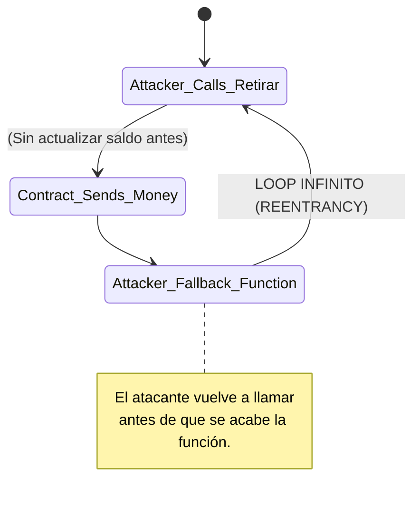
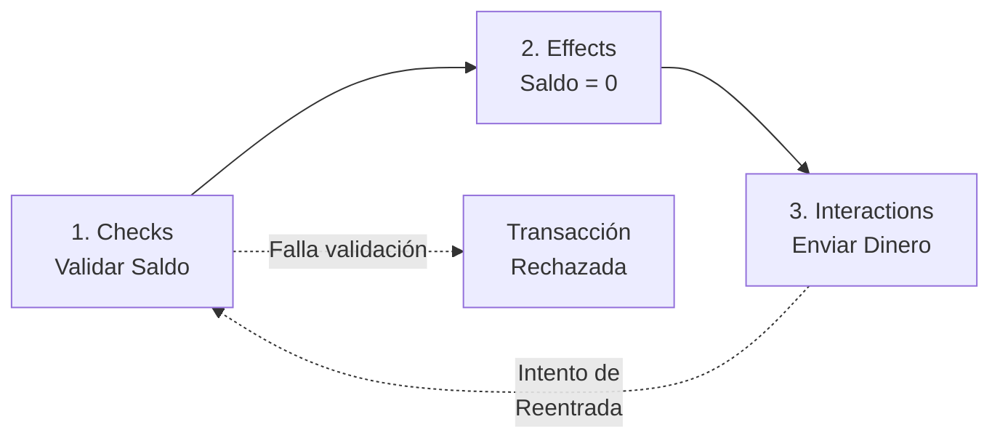
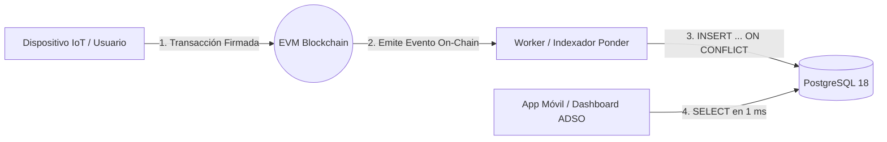

# 02 · Ejemplo Resuelto de Ingeniería: Diseño, Persistencia y Seguridad

Crear dinero programable y software distribuido exige un cambio radical de mentalidad: en la máquina virtual de Ethereum (EVM), un error lógico puede costar millones de dólares y el código desplegado es inmutable por naturaleza.

---

## 1. Patrones de Diseño Cruciales en Solidity

### El Patrón Check-Effects-Interactions (CEI)
El vector de ataque más destructivo en contratos inteligentes es la **reentrada (Reentrancy Exploit)**. Ocurre cuando un contrato víctima transfiere fondos a una dirección externa maliciosa *antes* de descontar el balance en sus variables de estado.



#### ❌ Enfoque Deficiente (Vulnerable a Reentrancia):
```solidity
function retirar() public {
    uint256 saldo = balances[msg.sender];
    require(saldo > 0, "Sin saldo");
    
    // MALA PRÁCTICA: Enviar el dinero ANTES de actualizar el saldo
    (bool exito, ) = msg.sender.call{value: saldo}("");
    require(exito, "Fallo el envio");
    
    balances[msg.sender] = 0; // Se actualiza demasiado tarde
}
```

#### ✅ Enfoque Profesional (Check-Effects-Interactions):


```solidity
function retirarSeguro() public {
    // 1. Checks: Validar condiciones de negocio
    uint256 saldo = balances[msg.sender];
    require(saldo > 0, "Sin saldo disponible");
    
    // 2. Effects: Actualizar el estado interno de la EVM
    balances[msg.sender] = 0; 
    
    // 3. Interactions: Realizar llamadas a contratos externos
    (bool exito, ) = msg.sender.call{value: saldo}("");
    require(exito, "Fallo el envio");
}
```

---

## 2. Persistencia y Arquitectura CQRS con PostgreSQL

Una de las dudas más frecuentes para el aprendiz de ADSO es si la blockchain sustituye las bases de datos relacionales tradicionales. **En el entorno corporativo se usan ambas mediante el patrón CQRS (Command Query Responsibility Segregation)**:

* **Escrituras (Commands) On-Chain:** La blockchain actúa como el registro de verdad inmutable. Los nodos validadores (Geth, Besu) almacenan las modificaciones en bases NoSQL embebidas de bajísima latencia (**LevelDB** o **RocksDB**) organizadas en un **State Trie (Merkle Patricia Trie)** con codificación RLP.
* **Lecturas (Queries) Off-Chain:** **PostgreSQL** almacena la réplica indexada y optimizada para servir tableros de control, vistas hospitalarias, búsquedas textuales y agregaciones en menos de 1 milisegundo.



### Las 5 Reglas de Oro para Guardar Tokens en PostgreSQL:

1. **Cero Llaves Privadas:** Nunca almacenes claves privadas, frases mnemónicas ni contraseñas en la base de datos relacional. Solo se persisten hashes y direcciones públicas.
2. **Uso Obligatorio de `NUMERIC(78, 0)`:** En Solidity, los balances y tokens usan `uint256` (números de hasta 78 dígitos). El tipo `BIGINT` desborda; `NUMERIC(78, 0)` es el único tipo que preserva la precisión total.
3. **Idempotencia Absoluta:** Cada tabla de eventos debe contar con una clave primaria compuesta `(transaction_hash, log_index)` combinada con cláusulas `ON CONFLICT DO NOTHING` para tolerar reintentos de procesamiento.
4. **Tolerancia a Reorganizaciones (Reorgs):** Todo registro debe almacenar `block_number` y `block_hash` para posibilitar reversiones si un bloque queda huérfano durante una bifurcación de red.
5. **Reconstrucción Total:** PostgreSQL actúa como una vista materializada descartable. Si la base de datos se corrompe o se destruye, puede repoblarse al 100% releyendo la historia de bloques de la blockchain.

### Esquema DDL de referencia (ejemplo de arquitectura):

Este esquema ilustra cómo modelar varios casos. El aula usa el esquema de `backend/persistence/schema.cjs` y el Taller AgroPay crea la tabla `eventos_agropay` en `sql/001_proyeccion.sql`.
```sql
-- 1. Tokens Acuñados
CREATE TABLE tokens_registry (
    chain_id            BIGINT NOT NULL,
    contract_address    VARCHAR(42) NOT NULL,
    token_id            NUMERIC(78, 0) NOT NULL,
    owner_address       VARCHAR(42) NOT NULL,
    token_uri           TEXT,
    is_soulbound        BOOLEAN DEFAULT FALSE,
    is_burned           BOOLEAN DEFAULT FALSE,
    minted_at_block     BIGINT NOT NULL,
    minted_at_tx        VARCHAR(66) NOT NULL,
    created_at          TIMESTAMP WITH TIME ZONE DEFAULT NOW(),
    PRIMARY KEY (chain_id, contract_address, token_id)
);

-- 2. Nullifiers Electorales
CREATE TABLE electoral_nullifiers (
    nullifier_hash      VARCHAR(66) PRIMARY KEY,
    block_number        BIGINT NOT NULL,
    transaction_hash    VARCHAR(66) NOT NULL UNIQUE,
    candidate_id        INTEGER NOT NULL,
    zk_verification_ok  BOOLEAN NOT NULL DEFAULT TRUE,
    timestamp           TIMESTAMP WITH TIME ZONE DEFAULT NOW()
);

-- 3. Telemetría de Cadena de Frío
CREATE TABLE pharma_coldchain_telemetry (
    log_id              BIGSERIAL PRIMARY KEY,
    batch_id            VARCHAR(66) NOT NULL,
    recorded_temp_c     NUMERIC(4, 2) NOT NULL,
    hardware_signer_pub VARCHAR(42) NOT NULL,
    ecdsa_signature     VARCHAR(132) NOT NULL,
    block_number        BIGINT NOT NULL,
    tx_hash             VARCHAR(66) NOT NULL,
    status              VARCHAR(20) NOT NULL
);
```

---

## 3. Arquitectura Full-Stack de 6 Capas de Software

Una solución empresarial no se limita al contrato inteligente; se compone de seis capas interconectadas:

1. **Capa 1: Firmware IoT (C / C++ & MicroPython):** Microcontroladores ESP32 acoplados a criptochips **Microchip ATECC608A** y sondas térmicas **PT100**.
2. **Capa 2: Lógica de Consenso (Solidity & Vyper):** Reglas de negocio inmutables ejecutadas en los nodos validadores.
3. **Capa 3: Privacidad ZK:** Pruebas de conocimiento cero para elecciones. En esta guía se usa Semaphore con circuitos ya compilados; no se programan circuitos.
4. **Capa 4: Middleware e Indexación:** Servicios que escuchan eventos on-chain e insertan en PostgreSQL. En la industria se usan herramientas como The Graph o Ponder; en esta guía, el indexador está escrito en JavaScript (etapa 5 del taller).
5. **Capa 5: Interfaz de Usuario (React / Next.js + Tailwind):** Vistas web y móviles que interactúan con los nodos vía JSON-RPC mediante **Viem** y **Wagmi**.
6. **Capa 6: Identidad & UX (WebAuthn / Passkeys):** Autenticación biométrica nativa (FaceID / TouchID) sobre curvas `secp256r1`, eliminando la necesidad de extensiones de navegador y frases semilla gracias a **Smart Accounts ERC-4337** con tarifas de gas cubiertas por **Paymasters**.

## Para tu evidencia MG-A02

Este documento respalda la ficha del módulo 2, paso Aplica (`#m2/3`).

- **Observa:** registra un dictamen aprobado y uno rechazado de la etapa 1 del taller o del laboratorio Cadena de frío.
- **Explica:** usa la separación entre escrituras en la cadena y lecturas en PostgreSQL (sección 2) y las seis capas (sección 3) para asignar cada responsabilidad a un solo componente e indicar si su dato vive dentro o fuera de la cadena.
- **Tu proyecto:** nombra tres actores del proceso que elegiste en MG-A01 y quién puede escribir cada dato.
