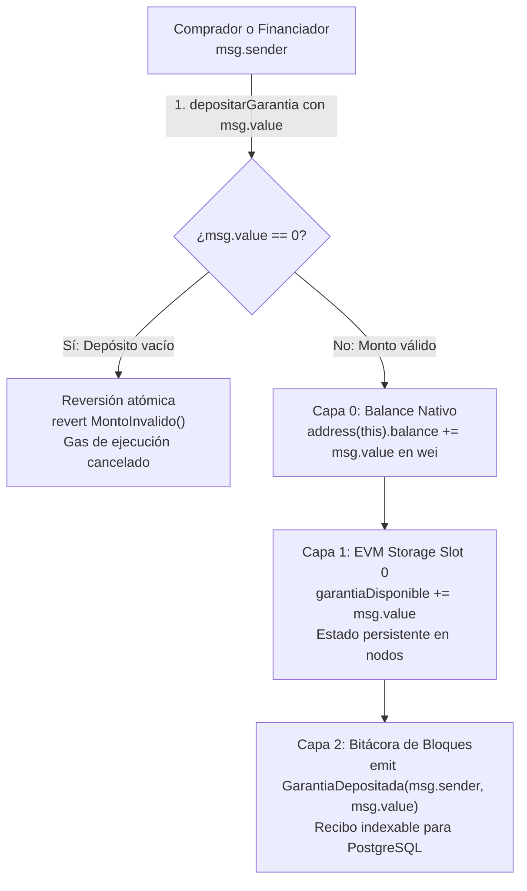

# 03 · Implementación: inspecciona y comprende el Taller AgroPay

La implementación completa de referencia vive en el **Taller AgroPay** de la guía web (`#taller`). El taller trabaja en JavaScript, Solidity y SQL nativo, y viene 100 % implementado para que el aprendiz no tenga que escribir código sintáctico desde cero, sino concentrarse en comprender la arquitectura, dónde se guardan los datos y cómo funciona esta nueva capa de seguridad verificable.

## Qué inspeccionas en el contrato

| Etapa | Archivo | Qué analizas y compruebas |
|---|---|---|
| 0 · Prepara el proyecto | `package.json`, `hardhat.config.js` | El proyecto compila y la etapa 0 pasa directamente. |
| 2 · Almacenamiento en EVM | `contracts/GarantiaAgroPay.sol` | Variables de estado (`garantiaDisponible`), modificador `payable` y emisión de eventos. |
| 3 · Permisos y retiro seguro | `contracts/GarantiaAgroPay.sol` | Control de acceso (`SoloOraculo`), mappings y retiro con Checks–Effects–Interactions (CEI). |

## Almacenamiento en EVM y custodia de garantía (Etapa 2)

### Analogía del mundo real: Depósito en garantía (escrow) y cuenta empresarial

En las finanzas corporativas tradicionales, cuando un comprador pacta la adquisición de una cosecha, no deposita el dinero en la cuenta personal del productor antes de recibir la mercancía, ni se limita a prometer el pago verbalmente. Las partes recurren a una **cuenta en custodia (escrow)** administrada por un tercero de confianza.

En el mundo de los contratos inteligentes, **el contrato `GarantiaAgroPay.sol` asume el rol de custodio neutral**. Para comprender su funcionamiento interno, el desarrollador debe distinguir con precisión tres conceptos que suelen confundirse al llegar desde la programación tradicional:

1. **El dinero custodiado (`address(this).balance` en wei):** Es la cantidad total de criptomoneda nativa que la red reconoce bajo la dirección pública del contrato. Aumenta cada vez que una cuenta ejecuta una función marcada con `payable` (como `depositarGarantia()`) transfiriendo valor.
2. **La variable contable interna (`uint256 public garantiaDisponible`):** Es una ranura (*storage slot*) de 32 bytes dentro del disco permanente de la EVM. Lleva el libro contable de cuántos fondos están libres para respaldar nuevos lotes. Cuando el oráculo autoriza un pago a un productor, `garantiaDisponible` disminuye y se acredita a `saldoPendiente[productor]`, pero el dinero físico (`address(this).balance`) continúa intacto en la bóveda del contrato hasta que el productor invoca `retirar()`.
3. **La bitácora pública de eventos (`event GarantiaDepositada`):** Es un recibo criptográfico sellado en los bloques de la cadena. No consume ranuras de almacenamiento interno y los contratos inteligentes no pueden leerlo; su misión es notificar a los indexadores off-chain (PostgreSQL) que los fondos ya ingresaron a la red.

### Flujo transaccional de depósito y validación en la EVM



### Cuadro comparativo de persistencia y almacenamiento en la EVM

| Dimensión | EVM Storage | Bytecode Inmutable | Logs / Eventos | Balance Nativo |
|---|---|---|---|---|
| **Ubicación física** | Ranuras (slots) de 32 bytes en el World State Trie | Código binario desplegado de la cuenta | Árbol de recibos (*Receipts Root*) en cada bloque | Estado de cuenta de la EVM (*Account State Trie*) |
| **Mutabilidad** | Modificable mediante transacciones y ejecución de código | Inmutable; se define en el constructor al desplegar | Inmutable y permanente en la historia de la cadena | Modificable mediante transferencias `payable` y `call` |
| **Acceso desde Solidity** | Lectura y escritura directa en tiempo de ejecución | Lectura directa (se incrusta en el bytecode) | Solo emisión (`emit`). **Inaccesible para contratos** | Lectura con `address(this).balance` |
| **Costo computacional** | Muy alto (`SSTORE` hasta 22.100 gas; `SLOAD` 2.100 gas) | Sin costo de storage slot; económico de ejecutar | Reducido (~375 gas base + tópicos indexados) | Gestión nativa del protocolo Ethereum |
| **Rol en AgroPay** | `garantiaDisponible`, `saldoPendiente`, `loteAutorizado` | `immutable oraculo` (dirección verificadora) | `GarantiaDepositada`, `PagoAutorizado`, `PagoRetirado` | Custodia física de fondos en wei |

Para verificar esta arquitectura en la terminal del taller, ejecuta:

```powershell
npm run etapa:2
npm run inspeccionar:estado
```

## Cómo explorar el taller

1. Revisa la página **Prepara tu equipo** (`#preparar`) e instala Node.js 24 y VS Code.
2. Descarga `descargas/taller-agropay.zip` desde la guía y extráelo en Documentos.
3. En la carpeta `agropay-taller`, ejecuta:

```powershell
npm install
npm run verificar
npm run etapa:2
npm run etapa:3
```

Todas las pruebas pasan directamente, permitiéndote inspeccionar los archivos fuente y entender qué propiedades observables verifica cada prueba.

## Experimentos de seguridad guiados

Ejecuta el script dedicado de seguridad:

```powershell
npm run probar:seguridad
```

Observa cómo el sistema responde y neutraliza cuatro vectores de ataque comunes:
1. **Alteración de datos:** La firma ECDSA detecta cualquier cambio en la medición con `FIRMA_INVALIDA`.
2. **Ataque de repetición:** El control de `nonce` bloquea la reutilización de paquetes firmados con `LECTURA_REPETIDA`.
3. **Suplantación de permisos:** La EVM revierte llamadas no autorizadas con `SoloOraculo`.
4. **Ataque de reentrada:** El contrato atacante `AtacanteRetiro` es frustrado porque el saldo se reduce a cero antes de transferir dinero (patrón CEI).

Las pruebas que validan esta etapa están en [04-validacion.md](04-validacion.md).
