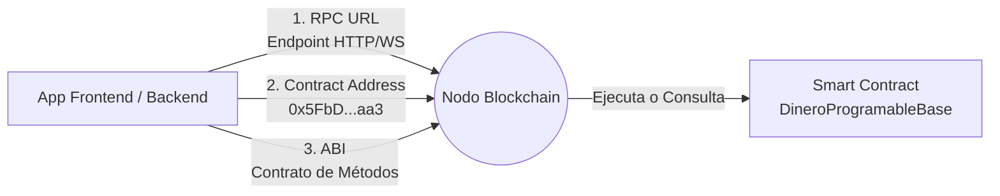

# 03b · Guía de Implementación en Aplicaciones, Redes y Coolify

> **Programa:** Tecnólogo en Análisis y Desarrollo de Software (ADSO SENA)  
> **Competencia:** 220501096 · Desarrollar la solución de software de acuerdo con el diseño y metodologías  
> **Resultado de Aprendizaje:** RAP-01 · Aplicar los fundamentos de Dinero Programable e IA con trazabilidad técnica  

---

## 🏛️ 1. El Modelo Mental: Cómo Conectar Software Tradicional a la Blockchain

Para un desarrollador de software que da sus primeros pasos en Web3, la blockchain no es un misterio esotérico: **es una base de datos distribuida de solo adición (append-only) que ejecuta código de backend (Smart Contracts) de forma inmutable y descentralizada**.

Cualquier aplicación tradicional (un frontend en React o una API en Python) necesita únicamente tres datos para interactuar con un contrato inteligente:



1. **RPC URL (Remote Procedure Call):** La URL del nodo con el que hablas (ej. `http://127.0.0.1:8545` en local o `https://rpc.sepolia.org` en testnet).
2. **Contract Address:** La dirección hexadecimal de 42 caracteres donde el contrato fue desplegado (ej. `0x5FbDB2315678afecb367f032d93F642f64180aa3`).
3. **ABI (Application Binary Interface):** El archivo JSON que describe qué funciones y eventos existen, qué argumentos reciben y qué retornan. Es idéntico a un contrato OpenAPI/Swagger o una interfaz TypeScript.

---

## 📱 2. Implementación Paso a Paso en el Frontend (React / Vue / Vanilla JS)

### Operación 1: Lecturas Gratuitas (View Calls - Cero Gas)
Las consultas de estado a la blockchain no modifican variables, por lo que **no requieren billetera, no gastan gas y responden en milisegundos**:

```javascript
import { ethers } from "ethers";

const RPC_URL = "http://127.0.0.1:8545";
const CONTRACT_ADDRESS = "0x5FbDB2315678afecb367f032d93F642f64180aa3";
const CONTRACT_ABI = [
  "function totalEnGarantia() view returns (uint256)",
  "function saldosPendientes(address beneficiario) view returns (uint256)",
  "event PagoAutorizadoPorIA(uint256 indexed idLote, address indexed beneficiario, uint256 monto, uint256 puntaje)"
];

// Conexión mediante JsonRpcProvider (solo lectura)
const provider = new ethers.JsonRpcProvider(RPC_URL);
const contrato = new ethers.Contract(CONTRACT_ADDRESS, CONTRACT_ABI, provider);

async function obtenerEstadoFinanciero(cuentaUsuario) {
  const balanceGarantia = await contrato.totalEnGarantia();
  const saldoPendiente = await contrato.saldosPendientes(cuentaUsuario);

  console.log("Fondo en Escrow:", ethers.formatEther(balanceGarantia), "ETH");
  console.log("Tu saldo disponible para retiro:", ethers.formatEther(saldoPendiente), "ETH");
}
```

### Operación 2: Escrituras On-Chain con Billetera (Retiro de Fondos)
Cuando el usuario retira su dinero mediante el patrón Pull (`retirarMiDinero`), la transacción altera el estado de la EVM, por lo que **requiere firma criptográfica y paga una fracción de gas**:

```javascript
async function retirarMisFondos() {
  if (!window.ethereum) throw new Error("Debes instalar MetaMask o usar una Smart Account.");

  // Obtenemos el proveedor inyectado y la cuenta activa
  const browserProvider = new ethers.BrowserProvider(window.ethereum);
  const signer = await browserProvider.getSigner();

  // Instanciamos el contrato con permisos de escritura
  const contratoEscritura = new ethers.Contract(CONTRACT_ADDRESS, CONTRACT_ABI, signer);

  console.log("Enviando transacción...");
  const tx = await contratoEscritura.retirarMiDinero();
  console.log("Hash emitido:", tx.hash);

  // Esperamos la inclusión en el bloque
  const receipt = await tx.wait();
  console.log("¡Retiro exitoso confirmado en bloque:", receipt.blockNumber);
}
```

### Operación 3: Escucha Reactiva de Eventos en Vivo
Para que la interfaz web se actualice instantáneamente cuando la IA autoriza un pago:

```javascript
contrato.on("PagoAutorizadoPorIA", (idLote, beneficiario, monto, puntaje) => {
  console.log(`[Push Notification] Lote #${idLote} aprobado con calidad del ${puntaje}%.`);
  // Aquí actualizas el estado visual de tu componente React sin recargar
});
```

---

## 🤖 3. Implementación del Agente de IA Oráculo (Node.js & Python)

Los Smart Contracts no pueden conectarse directamente a internet por diseño determinista. Para que la IA decida cuándo se libera un pago, un servicio backend seguro actúa como **Oráculo**:

### En Node.js (`scripts/agente-ia-oraculo.js`):
```javascript
const { ethers } = require("ethers");

async function oraculoIA(lote, beneficiario, montoEth) {
  // 1. Inferencia del modelo de IA (análisis de calidad)
  const puntajeIA = await analizarCalidadConGemini(lote); // ej. 95/100

  if (puntajeIA < 90) {
    console.warn("Calidad insuficiente. Los fondos permanecen en garantía.");
    return;
  }

  // 2. Firmar con la clave privada del Oráculo (almacenada en variable de entorno)
  const provider = new ethers.JsonRpcProvider(process.env.RPC_URL);
  const walletOraculo = new ethers.Wallet(process.env.ORACLE_PRIVATE_KEY, provider);

  const contrato = new ethers.Contract(CONTRACT_ADDRESS, CONTRACT_ABI, walletOraculo);

  // 3. Emitir autorización on-chain
  const tx = await contrato.autorizarPagoCondicional(
    lote.id,
    beneficiario,
    ethers.parseEther(montoEth.toString()),
    puntajeIA
  );
  await tx.wait(1);
  console.log("Desembolso programado exitosamente por la IA:", tx.hash);
}
```

### En Python (`scripts/agente_ia_oraculo.py`):
Los servicios de IA construidos sobre FastAPI, PyTorch o scikit-learn pueden utilizar la biblioteca `web3.py` para firmar transacciones con su clave privada y enviarlas al endpoint JSON-RPC sin intermediarios.

---

## 🪙 4. Dinero Programable con Stablecoins ERC-20 (USDC/USDT)

En aplicaciones empresariales y gubernamentales reales, **no se utiliza ETH volátil para pagar contratos de obra o compras de cosechas**. Si el precio del token fluctúa un 20% en una semana, las partes pierden certeza económica. Se utilizan **Stablecoins (ERC-20)** como USDC o USDT.

### El Patrón de Dos Pasos (`approve` + `transferFrom`):
Para que un contrato inteligente como [`DineroProgramableERC20.sol`](../contracts/DineroProgramableERC20.sol) custodie dinero de un tercero:
1. **Paso 1:** El usuario aprueba al contrato en el token ERC-20:  
   `usdcToken.approve(direccionContrato, monto)`
2. **Paso 2:** El usuario invoca la función de depósito:  
   `contrato.depositarGarantiaTokens(monto)` (el contrato ejecuta internamente `transferFrom`).

---

## 🌐 5. ¿En Qué Red se Puede Correr tu Aplicación?

| Red | Tipo | Costo de Gas | Latencia | Caso de Uso |
| :--- | :--- | :--- | :--- | :--- |
| **Local (Hardhat/Anvil)** | Desarrollo | $0.00 | 0 ms | Pruebas TDD, debugging con trazas completas. |
| **Hyperledger Besu (QBFT)** | Consorcio Privado | 0.00 GWEI | 1 a 2 seg | Contratación estatal (SENA/SECOP), gremios agropecuarios. Cero especulación. |
| **Sepolia / Polygon Amoy** | Testnet Pública | $0.00 (Faucets) | 2 a 12 seg | Staging y validación con MetaMask antes de producción. |
| **Capas 2 (Base, Arbitrum)** | Mainnet Producción | <$0.01 USD | 1 seg | Producción real de bajo costo para micropagos y stablecoins. |

---

## ☁️ 6. Publicar la guía en un VPS con Coolify

El desarrollo y las pruebas se hacen en tu equipo con Node.js nativo; Docker se usa solo para publicar en un servidor con Coolify.

- **Se publica:** la guía web (lecciones, laboratorios en Simulación, taller y su paquete descargable) en un único servicio `frontend`.
- **No se publica:** la modalidad Real local. Ejecuta herramientas y conversa con la red y PostgreSQL solo desde `127.0.0.1`.
- **No se ejecuta en el servidor:** la suite de pruebas diaria. Corre en tu equipo y en GitHub Actions.

Los pasos en Coolify están en el anexo **Publica la guía en tu VPS** de la guía web (`#publicar`).
