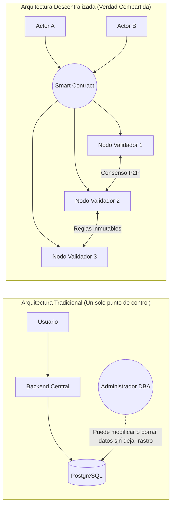
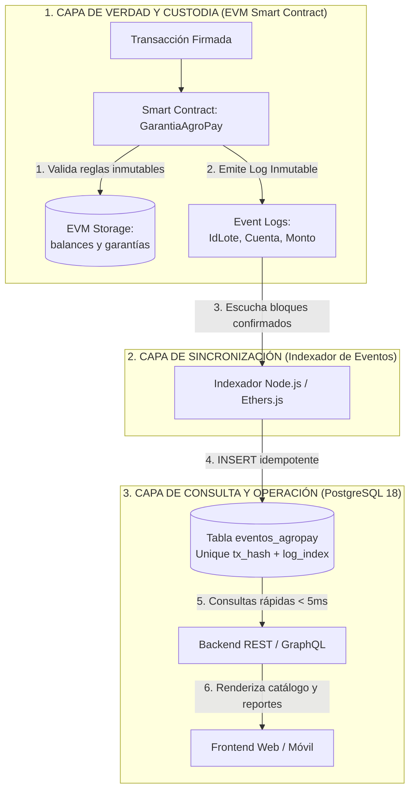
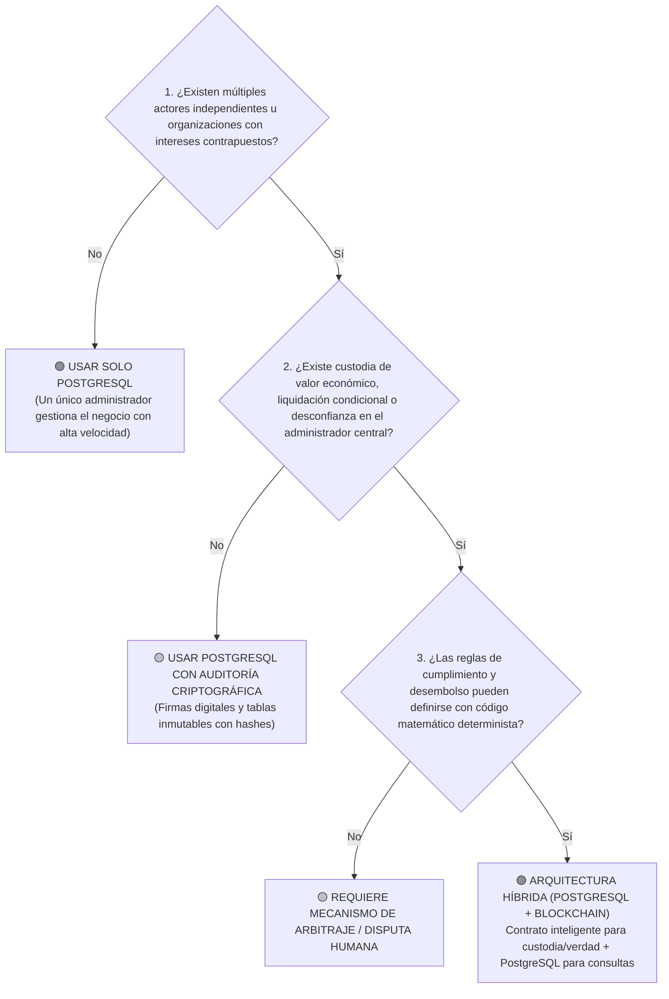

# Arquitectura Híbrida: Blockchain, Smart Contracts y PostgreSQL en Software ADSO
## Guía de Ingeniería para Aprendices e Instructores del SENA

> **Programa de Formación:** Tecnólogo en Análisis y Desarrollo de Software (ADSO)  
> **Competencia:** 220501096 · Desarrollar la solución de software de acuerdo con el diseño y metodologías de desarrollo  
> **Resultado de Aprendizaje:** Evaluar e integrar tecnologías descentralizadas y persistencia relacional en arquitecturas empresariales seguras.

---

## 1. La Gran Idea de la Cadena de Bloques: La Máquina de Verdad Compartida

Para entender la cadena de bloques (*blockchain*) sin mitos financieros, debes analizarla como ingeniero de software: **la blockchain no es una base de datos para almacenar archivos ni una alternativa lenta a PostgreSQL; es una máquina de estados criptográfica replicada y determinista**.

En ciencias de la computación, el estado de una máquina evoluciona mediante una función de transición:

$$S' = \Upsilon(S, T)$$

Donde el estado siguiente ($S'$) es el resultado estricto de aplicar una transacción firmada ($T$) sobre el estado actual ($S$). En una arquitectura tradicional (Web 2.0), esta función la ejecuta un único servidor central (tu backend en Node.js, Spring Boot o Django) y persiste en una base de datos que el administrador de sistemas puede alterar directamente con permisos de superusuario (`sudo` o rol `postgres`).

En una cadena de bloques:
1. **No existe un administrador omnipotente:** Cientos o miles de nodos validadores independientes ejecutan exactamente el mismo código bytecode en su máquina virtual (EVM) y verifican las mismas firmas criptográficas.
2. **Inmutabilidad demostrable:** Un registro no se puede borrar ni sobrescribir; solo se pueden anexar nuevas transacciones en bloques encadenados por hashes SHA-256 / Keccak-256.
3. **Prueba de verdad matemática:** La información es correcta porque está respaldada por una firma digital con curvas elípticas (ECDSA `secp256k1`), validada por consenso y sellada con una raíz de Merkle en un bloque inalterable.



---

## 2. Cómo se Guardan los Datos en PostgreSQL: El Patrón CQRS

Uno de los errores más costosos al iniciar en Web3 es intentar usar la blockchain como si fuera una base de datos relacional. 

### ¿Por qué no consultar directamente la Blockchain en tu aplicación?
* **Costo prohibitivo (Gas):** Guardar 1 MB en Ethereum o redes EVM principales cuesta sumas exorbitantes; las variables en `storage` están pensadas solo para números, direcciones y hashes.
* **Sin capacidades de consulta:** La EVM no tiene sentencias `SELECT`, ni cláusulas `WHERE`, ni ordenamientos `ORDER BY`, ni operadores `LIKE`, ni paginación rápida.
* **Latencia de red:** Consultar una colección completa a través de RPC (llamadas remotas a nodos) toma segundos y satura el navegador del usuario.

### La Solución de Grado Empresarial: CQRS (Command Query Responsibility Segregation)

Separamos la responsabilidad de **escribir y gobernar la verdad** de la responsabilidad de **consultar y reportar datos**:

1. **Modelo de Escritura y Verdad (Write Model - Blockchain):** El usuario interactúa con el Smart Contract firmando con su billetera o credencial segura. El contrato valida las reglas críticas, actualiza balances y emite un **Evento Inmutable** (`event PagoAutorizado(...)`).
2. **El Puente (Indexador de Eventos):** Un servicio en segundo plano (en Node.js o Python) escucha los eventos confirmados en la red.
3. **Modelo de Lectura y Rendimiento (Read Model - PostgreSQL):** El indexador proyecta los eventos en tablas normalizadas en PostgreSQL. Tu frontend consulta estas tablas en menos de 5 milisegundos con filtros avanzados, paginación y reportes.



### Esquema SQL Canónico y la Regla de Oro de la Idempotencia

En sistemas distribuidos, la red puede fallar, desconectarse o reintentar el procesamiento de un bloque. El indexador debe ser **idempotente**: procesar el mismo bloque dos veces debe producir exactamente el mismo resultado sin duplicar registros.

La clave primaria natural de un evento en blockchain es compuesta:
* `tx_hash`: Identificador criptográfico único de la transacción (66 caracteres hexadecimales).
* `log_index`: Posición secuencial del evento dentro de esa transacción específica.

```sql
-- DDL canónico de proyección en PostgreSQL
CREATE TABLE IF NOT EXISTS eventos_agropay (
  id         BIGSERIAL PRIMARY KEY,
  tx_hash    CHAR(66)       NOT NULL,
  log_index  INTEGER        NOT NULL,
  bloque     BIGINT         NOT NULL,
  tipo       TEXT           NOT NULL,
  id_lote    NUMERIC(78, 0),
  cuenta     CHAR(42)       NOT NULL,
  monto_wei  NUMERIC(78, 0) NOT NULL,
  creado_en  TIMESTAMPTZ    NOT NULL DEFAULT CURRENT_TIMESTAMP,
  UNIQUE (tx_hash, log_index)
);

CREATE INDEX IF NOT EXISTS idx_eventos_cuenta ON eventos_agropay (cuenta);
CREATE INDEX IF NOT EXISTS idx_eventos_lote ON eventos_agropay (id_lote);
```

Cuando el indexador recibe un evento, ejecuta la inserción con `ON CONFLICT DO NOTHING`:

```sql
INSERT INTO eventos_agropay (tx_hash, log_index, bloque, tipo, id_lote, cuenta, monto_wei)
VALUES ($1, $2, $3, $4, $5, $6, $7)
ON CONFLICT (tx_hash, log_index) DO NOTHING;
```

Si la base de datos sufriera una falla total o pérdida de datos, **no se pierde nada**: basta con vaciar la tabla y ejecutar el proceso de *Replay* (reconstrucción histórica), leyendo los eventos desde el bloque génesis del contrato para regenerar el 100% de la proyección.

---

## 3. Cómo se Integra a los Proyectos de Software Construidos en el SENA ADSO

Los aprendices ADSO desarrollan comúnmente arquitecturas cliente-servidor:
* **Frontend:** React, Vue, Angular o Flutter.
* **Backend:** Node.js (Express/NestJS) o Java (Spring Boot).
* **Persistencia:** PostgreSQL o MariaDB.

Agregar blockchain **no significa rehacer el sistema**. Significa integrar un componente especializado que asume la custodia neutral de compromisos financieros o sellos de verdad.

### Snippet Canónico de Integración en Backend (Node.js + Ethers + PostgreSQL)

A continuación se muestra el módulo desacoplado que los aprendices pueden incorporar en su backend para sincronizar la cadena de bloques con su base de datos PostgreSQL:

```javascript
// servicio-indexador.js
// Integración canónica para backends Node.js / Express en proyectos ADSO
const { ethers } = require('ethers');
const { Pool } = require('pg');

const pool = new Pool({ connectionString: process.env.DATABASE_URL });

async function registrarEventoEnPostgres(log, nombreEvento, args) {
  const query = `
    INSERT INTO eventos_agropay (tx_hash, log_index, bloque, tipo, id_lote, cuenta, monto_wei)
    VALUES ($1, $2, $3, $4, $5, $6, $7)
    ON CONFLICT (tx_hash, log_index) DO NOTHING;
  `;
  const valores = [
    log.transactionHash,
    log.index,
    log.blockNumber,
    nombreEvento,
    args.idLote ? args.idLote.toString() : null,
    args.cuenta || args.productor || args.depositante,
    args.monto ? args.monto.toString() : '0',
  ];
  await pool.query(query, valores);
}

async function iniciarEscuchaDeEventos(direccionContrato, contratoAbi, rpcUrl) {
  const provider = new ethers.JsonRpcProvider(rpcUrl);
  const contrato = new ethers.Contract(direccionContrato, contratoAbi, provider);

  console.log(`Conectado al contrato en ${direccionContrato}. Escuchando eventos...`);

  contrato.on('PagoAutorizado', async (idLote, productor, monto, eventPayload) => {
    console.log(`[Evento] PagoAutorizado para lote ${idLote} a favor de ${productor}`);
    await registrarEventoEnPostgres(eventPayload.log, 'PagoAutorizado', { idLote, productor, monto });
  });

  contrato.on('PagoRetirado', async (productor, monto, eventPayload) => {
    console.log(`[Evento] PagoRetirado por ${productor} monto ${monto}`);
    await registrarEventoEnPostgres(eventPayload.log, 'PagoRetirado', { productor, monto });
  });
}

module.exports = { iniciarEscuchaDeEventos, registrarEventoEnPostgres };
```

---

## 4. Marco de Decisión: El Semáforo ADSO (¿Dónde y Por Qué Usarlo?)

Para sustentar con madurez técnica tu proyecto formativo ante los instructores o ante una empresa, debes saber decir **«Aquí NO se necesita blockchain»** con tanta convicción como **«Aquí SÍ se justifica»**.

### El Filtro de las 3 Preguntas de Ingeniería

Para cada módulo o requerimiento de tu software, hazte estas tres preguntas consecutivas:



### Tabla del Semáforo ADSO

| Nivel | Cuándo usarlo | Tecnologías sugeridas | Ventajas observables |
| :--- | :--- | :--- | :--- |
| 🟢 **Verde: Solo PostgreSQL** | El 95 % de los casos comunes: inventarios, perfiles, sesiones, compras internas, facturación donde el emisor es la única autoridad. | PostgreSQL 18, Índices B-Tree, Triggers, Vistas Materializadas. | Velocidad extrema (< 1 ms), costo cero en transacciones, facilidad para respaldar y modificar. |
| 🟡 **Amarillo: PostgreSQL con Criptografía** | Auditoría forense donde los usuarios quieren verificar que sus registros no fueron alterados después de creados. | PostgreSQL + Funciones Hash (SHA-256) + Firmas digitales ECDSA. | Trazabilidad verificable sin la sobrecarga de operar un nodo ni pagar gas de red. |
| 🟣 **Púrpura: Arquitectura Híbrida (PostgreSQL + Smart Contracts)** | Custodia de fondos compartidos (escrow), liquidaciones automáticas entre campesinos e industrias, títulos y certificados verificables globalmente por terceros. | EVM (Solidity) + Ethers.js + Indexador CQRS + PostgreSQL. | Confianza matemática absoluta: ninguna parte puede alterar el dinero depositado ni las condiciones acordadas. |

---

## 5. Análisis de Casos Prácticos en Proyectos Formativos ADSO

A continuación se analizan cuatro proyectos típicos de aprendices del SENA y la recomendación técnica exacta:

### Caso 1: Sistema de Inventario y Ventas para Ferretería
* **Problema:** Control de entradas, salidas de mercancía y facturación de caja.
* **Diagnóstico:** Los actores pertenecen a una sola empresa (cajeros, bodegueros, dueño). El dueño confía en su base de datos.
* **Decisión:** **100 % PostgreSQL**. Usar blockchain aquí es un error arquitectónico: añade costo, lentitud y complejidad innecesaria.

### Caso 2: Plataforma de Calificaciones Académicas y Asistencia
* **Problema:** Los instructores suben notas parciales y asistencias semanales. Al final del programa, se emite el título oficial de Tecnólogo ADSO.
* **Diagnóstico:** Las notas semanales cambian constantemente (correcciones, reclamos). Pero el título final debe ser verificable por empresas sin llamar al centro de formación.
* **Decisión Híbrida:**
  * **Notas y asistencias:** En PostgreSQL (edición ágil y consultas privadas).
  * **Título oficial de grado:** Se calcula el hash SHA-256 del diploma PDF y se acuña en un contrato de certificados. Cualquier empleador en el mundo valida la autenticidad en 1 segundo sin pedir usuario ni contraseña.

### Caso 3: Trazabilidad de Café Especial y Denominación de Origen
* **Problema:** Una federación de 200 caficultores vende café a tostadores en Europa. Quieren certificar que el café es 100 % orgánico y de altura.
* **Diagnóstico:** Los compradores europeos no confían en una base de datos privada que el exportador local pueda alterar antes de embarcar.
* **Decisión Híbrida:**
  * **Detalles del cultivo y fotos:** En PostgreSQL y almacenamiento distribuido (IPFS).
  * **Sello del lote y dictamen de cata:** Hash criptográfico firmado por el catador certificado registrado on-chain en el contrato inteligente del lote.

### Caso 4: AgroPay (Liquidación Lechera Condicionada a Calidad)
* **Problema:** Una procesadora lechera compra leche a pequeños ganaderos. Históricamente, los campesinos desconfían de los descuentos aplicados por supuesta mala calidad bacteriana o acidez.
* **Diagnóstico:** Conflicto de interés financiero directo entre comprador y vendedor.
* **Decisión Híbrida (Implementada en el Taller):**
  * **Custodia neutral del dinero:** La procesadora deposita el presupuesto en el contrato inteligente `GarantiaAgroPay.sol`. Los fondos quedan bloqueados en custodia (Escrow).
  * **Dictamen neutral e imparcial:** El oráculo con inteligencia artificial evalúa los sensores (temperatura y acidez) y firma criptográficamente la aprobación.
  * **Desembolso autónomo:** El contrato verifica la firma y libera el pago directo a la cuenta del productor sin mediación humana.
  * **Reportes y visualización:** PostgreSQL proyecta los eventos para que la empresa y el campesino consulten su historial al instante desde su celular.
