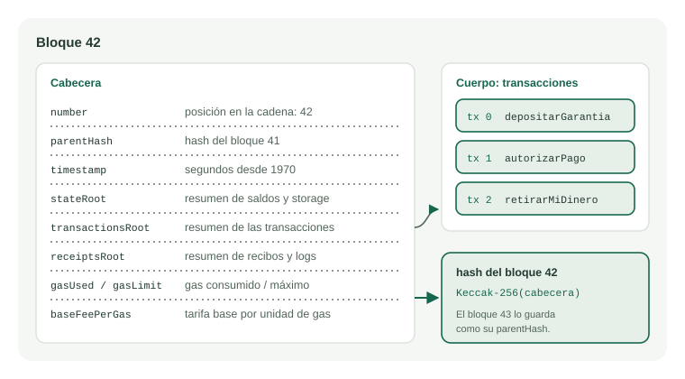
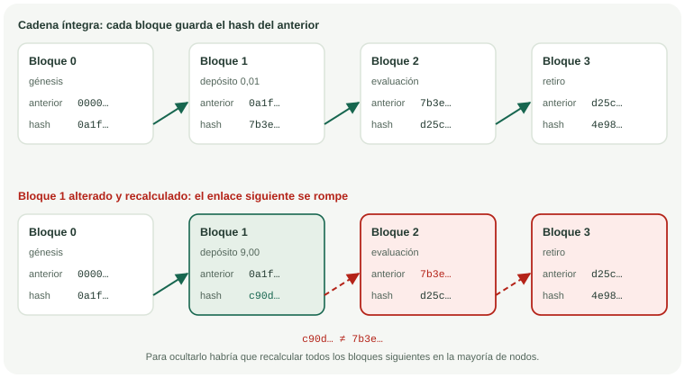
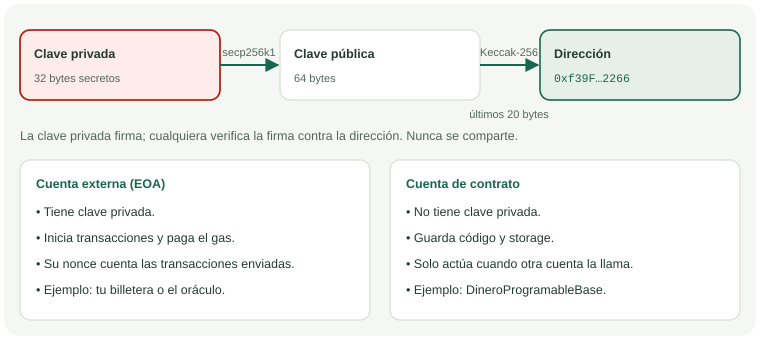
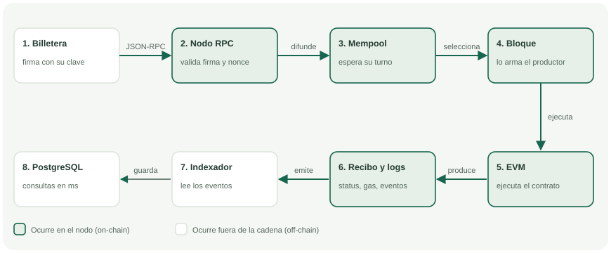
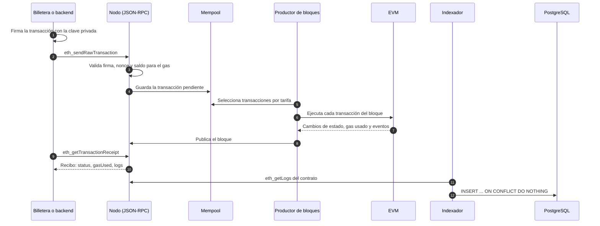
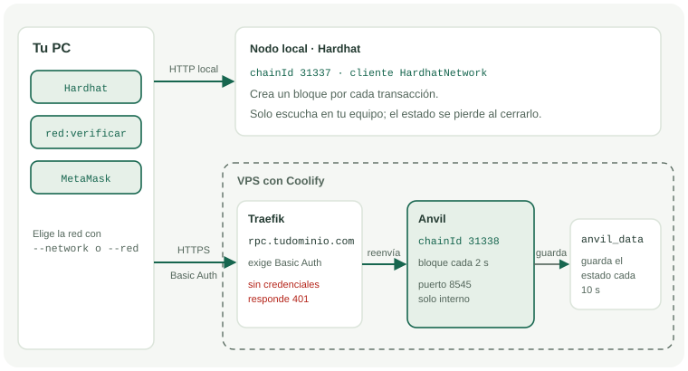
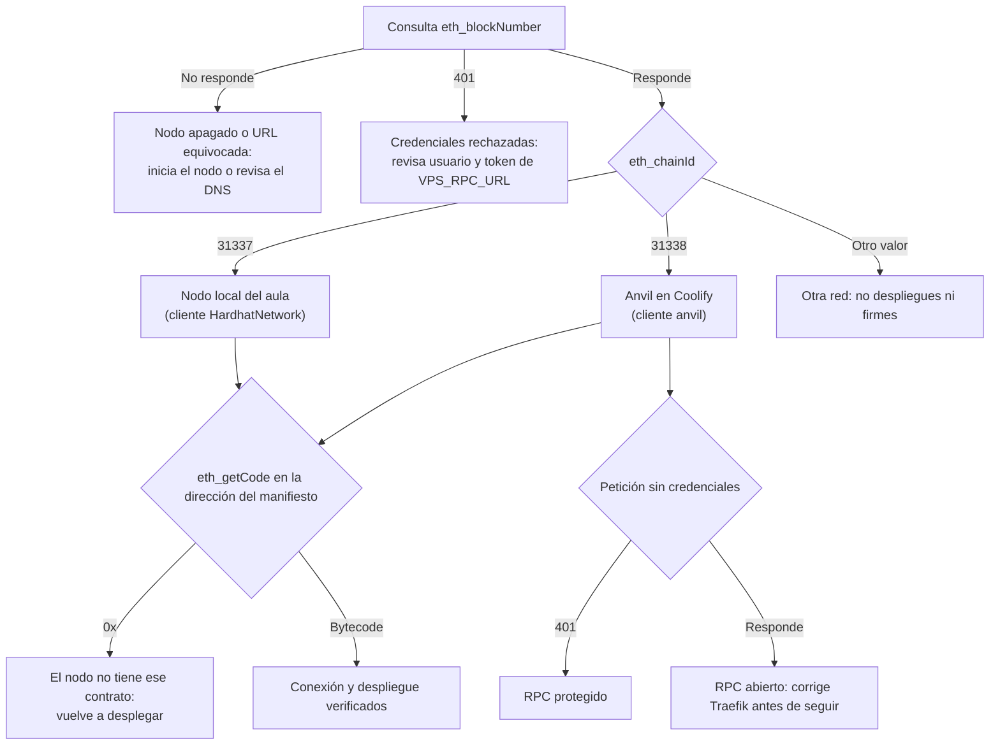

# Cómo funciona una cadena de bloques y cómo verificar a qué nodo te conectas

Los casos y archivos de esta guía se prepararon para aprender y no contienen registros reales. Las cuentas, claves y fondos de los nodos de práctica son públicos y no tienen valor: nunca los uses con dinero real.

Este documento acompaña el módulo 1 de la guía web (`#m1/0`) y el laboratorio 13, «Cadena de bloques». Explica qué guarda un bloque, cómo viaja una transacción y cómo comprobar desde tu PC si hablas con el nodo local del aula o con el Anvil que publicaste en Coolify.

---

## 1. Qué es la cadena de bloques

Una cadena de bloques es un **registro compartido que solo crece**. Muchos nodos guardan una copia, aplican las mismas reglas y aceptan un cambio únicamente si llega dentro de un bloque válido. Nadie edita una fila antigua: para cambiar algo se agrega una transacción nueva.

Conviene separar dos ideas:

- **El historial** es la secuencia de bloques con todas las transacciones desde el bloque génesis. Sirve para auditar qué pasó y en qué orden.
- **El estado** es la foto actual que resulta de aplicar ese historial: saldos, código de los contratos y su `storage`. Es lo que consultas cuando lees un saldo.

La [arquitectura híbrida](ARQUITECTURA_BLOCKCHAIN_Y_POSTGRES_ADSO.md) presenta esta idea como una máquina de estados replicada: cada transacción firmada transforma el estado anterior en uno nuevo, y todos los nodos obtienen el mismo resultado porque ejecutan el mismo código.

## 2. Anatomía de un bloque

Un bloque tiene una **cabecera**, que lo resume en pocos campos, y un **cuerpo**, que contiene las transacciones.



Esta es la respuesta real de `eth_getBlockByNumber` para el primer bloque de la red de Hardhat después de una transferencia de 0,01 ETH de práctica (se omitieron campos secundarios):

```json
{
  "number": "0x1",
  "hash": "0x1a17773bde06f516eac2d034ca1c1e6f0420502416e61388a1c2ee753d661abd",
  "parentHash": "0x1718ee6f253fe2757a135ff466a7006b0b2e0bd4a06c79458508376b3ff9a179",
  "timestamp": "0x6ae0ab0f",
  "miner": "0xc014ba5ec014ba5ec014ba5ec014ba5ec014ba5e",
  "stateRoot": "0x451427d9f5bf697cc7f627db8cfe33647a0f7c0c3bb3055c7f523d5f53d88090",
  "transactionsRoot": "0xa013445e7edab83f2871384cb9f3ea9f0852a681700710ab2bf17195c1804755",
  "receiptsRoot": "0xf78dfb743fbd92ade140711c8bbc542b5e307f0ab7984eff35d751969fe57efa",
  "gasUsed": "0x5208",
  "gasLimit": "0x3938700",
  "baseFeePerGas": "0x342770c0",
  "transactions": ["0x72cf8f17090c5c8c46ac833cb0cd6dd0273d429e5950377a89a6bb49a3083d59"]
}
```

Los números llegan en hexadecimal: `0x5208` es 21 000, el gas exacto de una transferencia simple.

| Campo | Qué significa | Valor del ejemplo |
|---|---|---|
| `number` | Posición del bloque en la cadena. | 1 |
| `hash` | Huella Keccak-256 de la cabecera. Identifica el bloque. | `0x1a17…1abd` |
| `parentHash` | Hash del bloque anterior. Es el enlace de la cadena. | Coincide con el hash del génesis. |
| `timestamp` | Segundos desde el 1 de enero de 1970 (hora Unix). | 1 793 108 751 |
| `miner` | Cuenta que recibe la propina del bloque. En Hardhat es una dirección fija de práctica. | `0xc014…ba5e` |
| `stateRoot` | Raíz de Merkle del estado completo después del bloque. | Cambia si cambia cualquier saldo. |
| `transactionsRoot` | Raíz de Merkle de las transacciones del cuerpo. | Cambia si se altera una transacción. |
| `receiptsRoot` | Raíz de Merkle de los recibos, que incluyen los eventos (`logs`). | Permite probar que un evento ocurrió. |
| `gasUsed` / `gasLimit` | Gas consumido por todas las transacciones / máximo permitido en el bloque. | 21 000 / 60 000 000 |
| `baseFeePerGas` | Tarifa base por unidad de gas, en wei. Se quema. | 875 000 000 wei (0,875 gwei) |

Una **raíz de Merkle** resume una lista larga en un solo hash. Si cambia un elemento de la lista, cambia la raíz; por eso basta comparar la cabecera para detectar una alteración en el cuerpo o en el estado.

## 3. Cómo se encadenan los bloques

Cada bloque guarda en `parentHash` el hash del bloque anterior, y su propio hash depende de toda su cabecera, incluido ese `parentHash`. El resultado es una cadena en la que cada eslabón compromete a todos los anteriores.



Si alguien cambia el contenido del bloque 1:

1. **Sin recalcular el hash**, el bloque 1 queda delatado: su hash ya no corresponde a su contenido.
2. **Recalculando el hash**, el bloque 1 parece correcto, pero el bloque 2 todavía guarda el hash anterior. El enlace se rompe.
3. Para ocultar el cambio tendría que recalcular todos los bloques siguientes y lograr que la mayoría de los nodos acepte su versión. En Ethereum, además, cada bloque lleva la firma del validador que lo propuso.

Pruébalo en la guía web: el laboratorio 13, «Cadena de bloques» (`#lab/blocks`), te deja alterar un bloque y recalcular su hash. En la modalidad Real local lee los últimos bloques de tu nodo y comprueba cada `parentHash`.

## 4. Cuentas, claves y direcciones



- La **clave privada** son 32 bytes secretos. Con la curva elíptica `secp256k1` se obtiene la **clave pública** (64 bytes).
- La **dirección** son los últimos 20 bytes del Keccak-256 de la clave pública, escritos en hexadecimal: `0xf39F…2266`.
- La clave privada **firma** las transacciones. Cualquier nodo verifica la firma y recupera la dirección que la produjo, sin conocer la clave.
- El **nonce** de una cuenta cuenta cuántas transacciones envió. Cada transacción nueva usa el siguiente nonce; así la red rechaza repeticiones y mantiene el orden.

Hay dos tipos de cuenta:

| Cuenta externa (EOA) | Cuenta de contrato |
|---|---|
| Tiene clave privada. | No tiene clave privada. |
| Inicia transacciones y paga el gas. | Solo actúa cuando otra cuenta la llama. |
| Ejemplos: tu billetera, la cuenta del oráculo. | Ejemplo: `DineroProgramableBase`. |

Las 20 cuentas de Hardhat y las 10 de Anvil usan claves **publicadas en su documentación**. Sirven para practicar en tu equipo; en una red expuesta a internet cualquiera puede usarlas.

## 5. Ciclo de vida de una transacción





Tres detalles prácticos:

- **El gas mide el trabajo**, no el dinero. La comisión es `gasUsed × (baseFeePerGas + propina)`. En el ejemplo: 21 000 × 0,875 gwei = 0,000018375 ETH más la propina. En los nodos de práctica ese valor no cuesta nada.
- **Una transacción puede incluirse y fallar.** Si el contrato ejecuta `revert`, el recibo trae `status: 0`, el estado no cambia y el gas consumido se cobra igual.
- **En Hardhat el mempool casi no se ve**: el nodo crea un bloque en cuanto recibe cada transacción (*automine*).

## 6. Consenso y finalidad

El **consenso** es el procedimiento con el que los nodos acuerdan cuál es el siguiente bloque. La **finalidad** es el momento a partir del cual revertir ese bloque exigiría destruir una parte enorme del capital que respalda la red.

| | Ethereum (red principal) | Nodo local de Hardhat | Anvil en Coolify |
|---|---|---|---|
| Quién produce bloques | Miles de validadores con ETH en garantía (prueba de participación). | Un solo proceso en tu PC. | Un solo contenedor en tu VPS. |
| Ritmo | Hasta un bloque cada 12 s (*slot*). | Un bloque por transacción. | Un bloque cada 2 s (`ANVIL_BLOCK_TIME`). |
| Finalidad | Tras dos épocas (unos 13 minutos). | Inmediata: no hay otros nodos. | Inmediata: no hay otros nodos. |
| Qué garantiza | Que nadie, ni siquiera un grupo grande, reescriba el historial sin perder su garantía. | Solo que el código se ejecuta igual que en la EVM. | Lo mismo que Hardhat, más persistencia y acceso compartido. |

Un nodo de aula **no tiene consenso descentralizado**: quien administra el VPS puede reiniciar la cadena. Sirve para aprender, probar y demostrar; no para custodiar valor real.

## 7. JSON-RPC: la puerta de entrada al nodo

Hardhat, ethers, MetaMask y Foundry hablan con el nodo mediante peticiones JSON-RPC sobre HTTP. Cada petición indica un método y sus parámetros:

```json
{"jsonrpc":"2.0","id":1,"method":"eth_blockNumber","params":[]}
```

| Método | Qué responde | Para qué lo usas |
|---|---|---|
| `eth_chainId` | Identificador de la red. | Saber en qué red estás. |
| `web3_clientVersion` | Software del nodo. | Distinguir Hardhat de Anvil. |
| `eth_blockNumber` | Número del último bloque. | Comprobar que el nodo responde y avanza. |
| `eth_getBlockByNumber` | Cabecera y transacciones de un bloque. | Inspeccionar `hash` y `parentHash`. |
| `eth_getCode` | Bytecode guardado en una dirección. | Confirmar que un contrato existe en ese nodo. |
| `eth_getBalance` | Saldo de una cuenta en wei. | Revisar fondos de práctica. |
| `eth_getTransactionReceipt` | Recibo de una transacción. | Ver `status`, gas usado y eventos. |

## 8. Verifica desde tu PC a qué nodo te conectas

Tu proyecto puede apuntar a dos nodos. El nodo local se inicia con `npm run node` o con `pwsh ./start-windows.ps1`; el Anvil de Coolify se configura con la [guía del servidor EVM](GUIA_SERVIDOR_EVM_COOLIFY_Y_USO_LOCAL.md). Como usan identificadores de red distintos, una comprobación de pocos segundos te dice con cuál estás hablando.



| Señal | Nodo local del aula | Anvil en Coolify |
|---|---|---|
| `eth_chainId` | `0x7a69` (31337) | `0x7a6a` (31338) |
| `web3_clientVersion` | `HardhatNetwork/…` | `anvil/v…` |
| Ritmo de bloques | Solo avanza cuando envías transacciones. | Avanza cada 2 s aunque nadie envíe nada. |
| Hash del bloque génesis | Cambia cada vez que reinicias el nodo. | Se conserva mientras exista el volumen `anvil_data`. |
| Código del contrato | Dirección de `artifacts/deployment.json`. | Dirección de `artifacts/deployment.vps.json`. |
| Petición sin credenciales | Responde: solo escucha en tu equipo. | Debe responder 401. |

### Opción 1: el verificador del proyecto

```powershell
npm run red:verificar -- --red local
```

Para el VPS, define antes la URL con tus credenciales de práctica (la sección 4 de la guía del servidor explica cómo):

```powershell
npm run red:verificar -- --red vps
```

El verificador consulta el nodo, compara el chainId esperado, identifica el software, anota el hash del génesis, mide si aparecen bloques nuevos y busca el contrato del manifiesto correspondiente. En el VPS también envía una petición **sin** credenciales y espera un 401. Muestra la URL con la contraseña oculta y, si algo falla, indica la acción siguiente. Termina con código de salida 1 cuando una comprobación falla.

### Opción 2: consultas manuales en PowerShell 7

`Invoke-RestMethod` **no envía** el usuario y la contraseña escritos dentro de la URL: el VPS respondería 401. Esta función separa las credenciales y las envía en la cabecera `Authorization`:

```powershell
function Invoke-Rpc([string]$Url, [string]$Metodo, [object[]]$Parametros = @()) {
  $uri = [Uri]$Url
  $destino = "$($uri.Scheme)://$($uri.Authority)$($uri.AbsolutePath)"
  $cabeceras = @{}
  if ($uri.UserInfo) {
    $par = [Uri]::UnescapeDataString($uri.UserInfo)
    $cabeceras.Authorization = 'Basic ' + [Convert]::ToBase64String([Text.Encoding]::UTF8.GetBytes($par))
  }
  $cuerpo = @{ jsonrpc = '2.0'; id = 1; method = $Metodo; params = $Parametros } | ConvertTo-Json -Compress
  (Invoke-RestMethod -Uri $destino -Method Post -ContentType 'application/json' -Headers $cabeceras -Body $cuerpo).result
}

# Nodo local
[Convert]::ToInt64((Invoke-Rpc 'http://127.0.0.1:8545' 'eth_chainId'), 16)   # 31337
Invoke-Rpc 'http://127.0.0.1:8545' 'web3_clientVersion'                       # HardhatNetwork/…

# Anvil en Coolify
[Convert]::ToInt64((Invoke-Rpc $env:VPS_RPC_URL 'eth_chainId'), 16)          # 31338
Invoke-Rpc $env:VPS_RPC_URL 'web3_clientVersion'                             # anvil/v…
(Invoke-Rpc $env:VPS_RPC_URL 'eth_getBlockByNumber' @('latest', $false)).parentHash
```

Si instalaste Foundry, `cast` hace las mismas consultas contra el nodo local:

```powershell
cast chain-id --rpc-url http://127.0.0.1:8545
cast client --rpc-url http://127.0.0.1:8545
cast block latest --rpc-url http://127.0.0.1:8545
```

### Cómo decidir con las respuestas



## 9. Diagnóstico

| Síntoma | Causa probable | Qué hacer |
|---|---|---|
| El verificador local dice «no respondió». | El nodo local no está iniciado. | Ejecuta `npm run node` en otra terminal o `pwsh ./start-windows.ps1`. |
| `eth_chainId` devuelve 31337 cuando esperabas el VPS. | `VPS_RPC_URL` apunta a `127.0.0.1` o la variable no existe en esa terminal. | Define `$env:VPS_RPC_URL` en la misma ventana de PowerShell y repite. |
| El VPS responde 401 con `Invoke-RestMethod`, pero Hardhat se conecta. | `Invoke-RestMethod` ignora las credenciales escritas en la URL. | Usa la función `Invoke-Rpc` de la sección 8 o el verificador. |
| El VPS responde sin credenciales. | El middleware de Basic Auth no está asociado al enrutador de Traefik, o Coolify creó otro enrutador con el dominio del servicio. | Usa el enrutador `anvil-rpc` de `docker-compose.anvil.yml`, define `ANVIL_RPC_DOMAIN` y deja vacío el dominio del servicio en Coolify. |
| El bloque del VPS no avanza. | `ANVIL_BLOCK_TIME` vacío o el contenedor está detenido. | Revisa la variable y el estado *Healthy* en Coolify. |
| `eth_getCode` devuelve `0x`. | El nodo se reinició sin estado o desplegaste en otra red. | Despliega de nuevo en esa red y conserva el manifiesto que corresponde. |
| El hash del génesis del VPS cambió. | Se perdió el volumen `anvil_data`: empezó una cadena nueva. | Revisa el volumen persistente y vuelve a desplegar. |
| MetaMask muestra saldos o nonces de otra red. | Guardaste el nodo local y el VPS con el mismo chainId. | Registra el VPS con chainId 31338 y borra los datos de actividad de la red anterior. |
