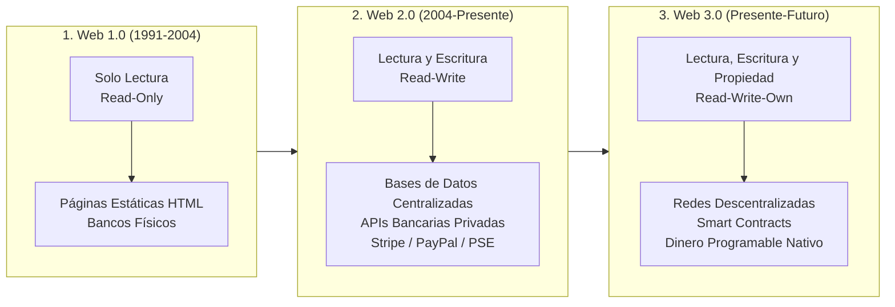
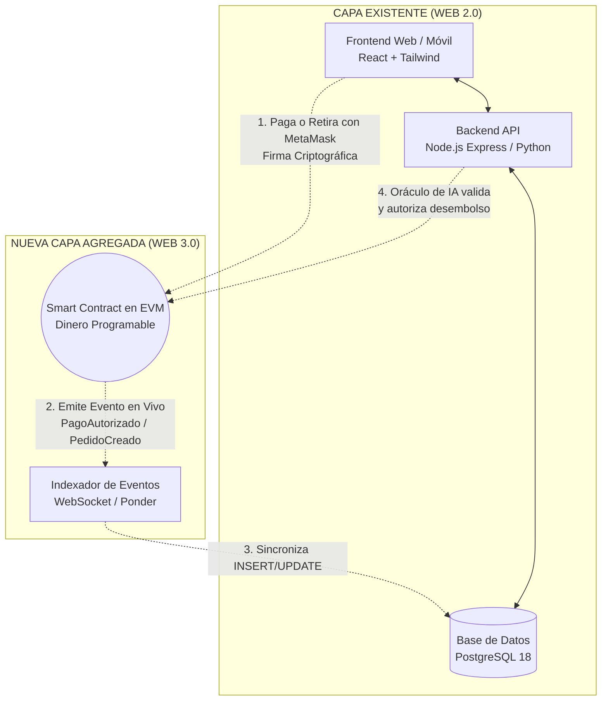

# 🚀 GUÍA MAESTRA: DE LA WEB 2 A LA WEB 3
## Cómo Coger una Aplicación Existente y Agregarle la Capa de Blockchain & Dinero Programable

> **Programa de Formación:** Tecnólogo en Análisis y Desarrollo de Software (ADSO SENA)  
> **Competencia:** 220501096 · Desarrollar la solución de software de acuerdo con el diseño y metodologías de desarrollo  
> **Resultado de Aprendizaje:** RAP-01 · Aplicar los fundamentos de Dinero Programable e IA con trazabilidad técnica y pedagógica  

---

## 🏛️ 1. INTRODUCCIÓN: DE LA WEB 2 A LA WEB 3 (EL CAMBIO DE PARADIGMA)

Para entender la tecnología blockchain sin mitos ni tecnicismos confusos, analiza la evolución de la web desde la perspectiva del flujo de datos y el dinero:



### Tabla Comparativa de Paradigmas:

| Dimensión | 🌐 Web 2.0 (Tradicional) | ⚡ Web 3.0 (Descentralizada) |
| :--- | :--- | :--- |
| **¿Quién custodia los datos?** | El servidor central de la empresa (AWS, GCP, PostgreSQL privado). | La red descentralizada de miles de nodos validadores sincronizados. |
| **¿Quién custodia el dinero?** | El banco comercial o la pasarela de pagos (Stripe, MercadoPago, PSE). | **El Smart Contract autónomo**, gobernado por código inmutable. |
| **Poder de censura** | **Total:** El banco puede bloquear cuentas, congelar fondos o rechazar pagos. | **Nulo:** Las matemáticas de la red validan cada transacción sin árbitros humanos. |
| **Identidad del usuario** | Correo electrónico y contraseña (vulnerables a filtraciones de bases de datos). | Billetera criptográfica (Llave pública y firma digital ECDSA). |
| **Disponibilidad** | Sujeta a horarios de oficina, festivos bancarios y caídas de servidores centrales. | **24/7/365 en todo el mundo sin interrupciones.** |

> 💡 **La Gran Revelación para el Desarrollador:**  
> Web3 **NO reemplaza a Web2 por completo**. Las aplicaciones del mundo real utilizan una **arquitectura híbrida**: la interfaz de usuario y las búsquedas rápidas corren en Web2 (React + PostgreSQL), mientras que la custodia del valor financiero, los acuerdos contractuales y la auditoría inmutable corren en Web3 (Smart Contracts en la EVM).

### 1.1 Ruptura de Paradigma: POO Tradicional (Java / C# / TypeScript) vs. Smart Contracts en la EVM
Para un aprendiz de software acostumbrado a la Programación Orientada a Objetos (POO), Solidity parece superficialmente una clase normal (`contract`, `constructor`, `functions`, `is`). Sin embargo:
* **En POO Tradicional:** Creas objetos temporales en la memoria RAM (Heap) que mueren al reiniciar el servidor. El cómputo en CPU no tiene costo marginal y la persistencia de datos requiere obligatoriamente una base de datos externa (`db.save()`).
* **En Smart Contracts (EVM):** Programas una **Máquina de Estados Criptográfica Replicada** ($S' = \Upsilon(S, T)$). Las variables en `storage` se graban automáticamente para siempre en los bloques de miles de nodos globales, cada instrucción cuesta gas medido estrictamente por la máquina virtual para resolver el problema de la parada de Turing, los errores con `require()` revierten el 100% de los cambios de forma atómica y el código desplegado es completamente inmutable.
> 📖 Para una profundización teórica y comparativas de código línea a línea, consulta el documento técnico especializado: [`docs/03c-paradigma-poo-vs-smart-contracts.md`](03c-paradigma-poo-vs-smart-contracts.md).

---

## 🏗️ 2. CÓMO COGER UNA APLICACIÓN YA PROGRAMADA Y AGREGARLE LA CAPA DE BLOCKCHAIN

Imagina que ya construiste tu proyecto formativo del SENA o un sistema para una empresa:
- Tienes un **Frontend** en React, Vue, Angular o HTML/JavaScript.
- Tienes un **Backend** en Node.js (Express/NestJS) o Python (FastAPI/Django).
- Tienes una **Base de Datos** en PostgreSQL o MySQL.

¿Cómo le añades la capa de blockchain sin romper ni tirar a la basura lo que ya funciona?

### El Patrón de Arquitectura Híbrida (Web2 + Web3)



### División Estratégica de Responsabilidades:

1. **Lo que se queda en Web2 (en tu base de datos PostgreSQL):**
   - Nombres de usuarios, correos, contraseñas hash (bcrypt).
   - Catálogo de productos, descripciones largas, imágenes y fotos.
   - Historiales de navegación y analítica de clics.
   - Búsquedas textuales complejas y paginación rápida (< 5 ms).

2. **Lo que se traslada a la Capa de Blockchain (Web3):**
   - **La custodia de los pagos (Escrow):** El dinero no va a la cuenta personal del administrador ni a un banco intermediario; queda bloqueado en el contrato inteligente.
   - **Las reglas de liquidación condicional:** El código estipula exactamente cuándo se desembolsan los fondos (ej. cuando la IA valida la calidad o el cliente confirma entrega).
   - **Los certificados y sellos inmutables:** Hashes criptográficos de títulos académicos, actas de grado o sellos de denominación de origen que nadie puede alterar ni borrar.

---

## ⚖️ 3. ALCANCES, LÍMITES Y CASOS DE USO REALES

### ✅ Alcances (Para qué SÍ sirve la Blockchain):
1. **Custodia Financiera Autónomo (Escrow):** Evita fraudes entre desconocidos. Ni el comprador ni el vendedor pueden engañarse porque el código custodia el dinero de forma neutral.
2. **Eliminación de Comisiones Bancarias Abusivas:** En redes Capa 2 (L2), transferir un pago internacional cuesta menos de \$0.005 USD frente al 3% + \$1.00 USD que cobran las pasarelas tradicionales.
3. **Auditoría Pública Inmutable:** Cualquier ciudadano, revisor fiscal o cliente puede verificar con un explorador de bloques que los fondos realmente están depositados y quién los autorizó.
4. **Agentes de IA con Autonomía Financiera:** Un modelo de IA puede tener su propia billetera y pagar APIs o liberar recompensas sin requerir intervención de una persona.

### ❌ Límites (Para qué NO sirve / Errores Fatales de Principiante):
1. **NO almacenar archivos pesados (Fotos, Videos, PDFs):**  
   Almacenar 1 MB de datos en la blockchain de Ethereum puede costar miles de dólares en gas. **La regla de oro:** Sube el archivo a almacenamiento distribuido (IPFS) o a tu servidor S3, calcula su hash SHA-256 y guarda únicamente el hash de 32 bytes on-chain.
2. **NO usarlo para telemetría de alta frecuencia:**  
   Si un sensor IoT lee temperatura cada segundo, no envíes 3.600 transacciones por hora a la red. Guarda las lecturas en PostgreSQL y envía a la blockchain solo un resumen horario o una alerta de violación de umbral.
3. **NO almacenar información personal privada sin cifrar:**  
   Todo lo que se escribe en una blockchain pública es visible para todo el planeta y no se puede borrar (lo que viola el "Derecho al Olvido" de las leyes de protección de datos como Habeas Data).

---

## 🛠️ 4. HERRAMIENTAS NECESARIAS Y CÓMO INSTALARLAS PASO A PASO

### Prerrequisitos en tu Sistema Operativo (Windows, macOS, Linux):

#### 1. Node.js (Versión LTS 20 o superior):
- **En Windows:** Abre PowerShell como Administrador y ejecuta:
  ```powershell
  winget install OpenJS.NodeJS.LTS
  ```
  *(O descárgalo desde [nodejs.org](https://nodejs.org)).*
- **En Linux (Ubuntu/Debian):**
  ```bash
  curl -fsSL https://deb.nodesource.com/setup_20.x | sudo -E bash -
  sudo apt-get install -y nodejs
  ```
- **Verificación en consola:**
  ```bash
  node -v   # Debe responder v20.x.x o superior
  npm -v    # Debe responder v10.x.x o superior
  ```

#### 2. Visual Studio Code y Extensiones Esenciales:
Descarga e instala Visual Studio Code y añade estas extensiones desde el Marketplace:
- **Solidity** (de *Nomic Foundation*): Coloreado de sintaxis, autocompletado y validación de tipos.
- **Hardhat for Visual Studio Code**: Resaltado de trazas de depuración y soporte para solc.

#### 3. Hardhat (El Framework Estándar de la Industria):
En la carpeta de tu proyecto, inicializa las dependencias:
```powershell
npm init -y
npm install --save-dev hardhat @nomicfoundation/hardhat-toolbox ethers
```

#### 4. Billetera Web3 (MetaMask):
Instala la extensión **MetaMask** en Chrome, Edge o Firefox.
- **Configuración para desarrollo local:**
  - Red: `Hardhat Local`
  - Nueva URL de RPC: `http://127.0.0.1:8545`
  - Identificador de cadena (Chain ID): `31337`
  - Símbolo de moneda: `ETH`

---

## 💻 5. TRES CASOS DE USO PROGRAMADOS DE PUNTA A PUNTA

### CASO DE USO 1: E-Commerce con Escrow Seguro (`TiendaEscrowWeb3.sol`)
Un cliente compra un producto en una tienda online. El pago no va al vendedor inmediatamente; queda en garantía en el Smart Contract y se libera solo cuando el producto es despachado y entregado.

#### 1. El Contrato Inteligente en Solidity:
```solidity
// SPDX-License-Identifier: MIT
pragma solidity ^0.8.24;

contract TiendaEscrowWeb3 {
    enum Estado { NO_EXISTE, BLOQUEADO, DESPACHADO, ENTREGADO }
    
    struct Pedido {
        address comprador;
        address vendedor;
        uint256 monto;
        Estado estado;
    }

    mapping(uint256 => Pedido) public pedidos;

    function pagarYBloquearEnEscrow(uint256 idPedido, address vendedor) external payable {
        require(msg.value > 0, "Monto invalido");
        require(pedidos[idPedido].estado == Estado.NO_EXISTE, "Pedido ya existe");

        pedidos[idPedido] = Pedido(msg.sender, vendedor, msg.value, Estado.BLOQUEADO);
    }

    function confirmarRecibidoYLiberarPago(uint256 idPedido) external {
        Pedido storage p = pedidos[idPedido];
        require(msg.sender == p.comprador, "Solo el comprador puede liberar");
        require(p.estado == Estado.BLOQUEADO || p.estado == Estado.DESPACHADO, "Estado invalido");

        uint256 monto = p.monto;
        p.estado = Estado.ENTREGADO;
        p.monto = 0; // Check-Effects-Interactions

        (bool ok, ) = p.vendedor.call{value: monto}("");
        require(ok, "Fallo transferencia");
    }
}
```

#### 2. La Conexión en el Frontend (React / JavaScript):
```javascript
import { ethers } from "ethers";

// El cliente confirma recibido y libera los fondos con 1 clic:
async function liberarPagoAlVendedor(idPedido) {
  const provider = new ethers.BrowserProvider(window.ethereum);
  const signer = await provider.getSigner();

  const contrato = new ethers.Contract(CONTRACT_ADDRESS, CONTRACT_ABI, signer);
  const tx = await contrato.confirmarRecibidoYLiberarPago(idPedido);
  
  console.log("Liberando pago on-chain. Hash:", tx.hash);
  await tx.wait();
  alert("¡Pago transferido con exito al vendedor!");
}
```

---

### CASO DE USO 2: AgroPay & Liquidación Condicional con IA
Sensores lecheros en Antioquia o Boyacá envían parámetros de acidez y temperatura. Si un modelo de IA en Python certifica que la leche llegó a menos de 4°C, el contrato autoriza el pago al campesino en Stablecoins USDC.

*(Ver implementación completa en [`contracts/DineroProgramableBase.sol`](../contracts/DineroProgramableBase.sol) y [`scripts/agente-ia-oraculo.js`](../scripts/agente-ia-oraculo.js). Para construirlo tú, sigue las etapas 3 y 4 del Taller AgroPay).*

---

### CASO DE USO 3: Certificados Académicos Inmutables SENA (`CertificadosInmutables.sol`)
El Centro de Formación emite diplomas o actas de grado. Para evitar la falsificación de títulos, se calcula el hash SHA-256 del archivo PDF y se sella en la blockchain.

#### 1. Registro del Certificado por el SENA:
```solidity
function emitirCertificado(bytes32 hashDocumento, string calldata codigo) external soloEmisor {
    certificados[hashDocumento] = Certificado(hashDocumento, codigo, block.timestamp, true);
}
```

#### 2. Verificación Pública a Costo Cero (Cualquier Empresa o Empleador):
```javascript
// La empresa sube el PDF del aspirante a una página web.
// El navegador calcula el hash SHA-256 y consulta el contrato (view call):
const hashPDF = ethers.sha256(archivoBuffer);
const [esAutentico, estaVigente, codigo] = await contrato.verificarAutenticidad(hashPDF);

if (esAutentico && estaVigente) {
  console.log(`✅ Certificado SENA 100% Auténtico. Código: ${codigo}`);
} else {
  console.warn("❌ Alerta: Documento no registrado o adulterado.");
}
```

---

## 🔍 6. CÓMO VERIFICAR QUE SE ESTÁ IMPLEMENTANDO CORRECTAMENTE

Para garantizar que tu solución es de grado de producción y no tiene fallos ocultos, ejecuta estas cuatro verificaciones:

1. **Verificación 1: Suite TDD Automatizada en tu Terminal:**
   ```powershell
   npx hardhat test
   ```
   *Criterio de éxito:* Todas las aserciones en Chai deben pasar en verde en milisegundos.

2. **Verificación 2: Inspección de Logs del Nodo EVM:**
   Abre una terminal dedicada y corre `npm run node` desde la carpeta de la guía. Observa que cada transacción que emites muestre:
   - `eth_sendRawTransaction`: Firma aceptada.
   - `Transaction mined`: Bloque confirmado con gas consumido.

3. **Verificación 3: Comprobación del Patrón Check-Effects-Interactions (CEI):**
   Revisa que tus contratos pongan los balances en cero (`balances[usuario] = 0;`) **antes** de ejecutar llamadas externas (`call{value: monto}("")`).

4. **Verificación 4: Sincronización Relacional CQRS:**
   Comprueba que tu backend en Node.js o Python escuche el evento emitido on-chain y actualice la tabla en PostgreSQL con un simple `SELECT * FROM pedidos WHERE estado = 'CUSTODIADO_EN_ESCROW';`.

---

## 🛡️ 7. CHECKLIST DE SEGURIDAD PARA EL APRENDIZ ADSO

- [ ] **Secretos Protegidos:** El archivo `.env` está en `.gitignore`. Ninguna clave privada o mnemónico está en el repositorio Git.
- [ ] **Precisión Numérica:** Los montos de dinero usan `uint256` en Solidity, `BigInt` o `ethers.parseUnits` en JavaScript, y `NUMERIC(78, 0)` en PostgreSQL.
- [ ] **Moneda Estable:** En pagos comerciales se utilizan tokens ERC-20 (USDC/USDT) con el patrón `approve` + `transferFrom` para blindar contra la volatilidad.
- [ ] **Control de Acceso Estricto:** Funciones críticas tienen modificadores (`soloAdmin`, `soloOraculoIA`) para impedir que usuarios no autorizados drenen fondos.
